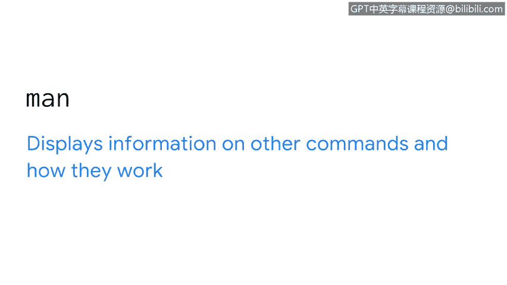
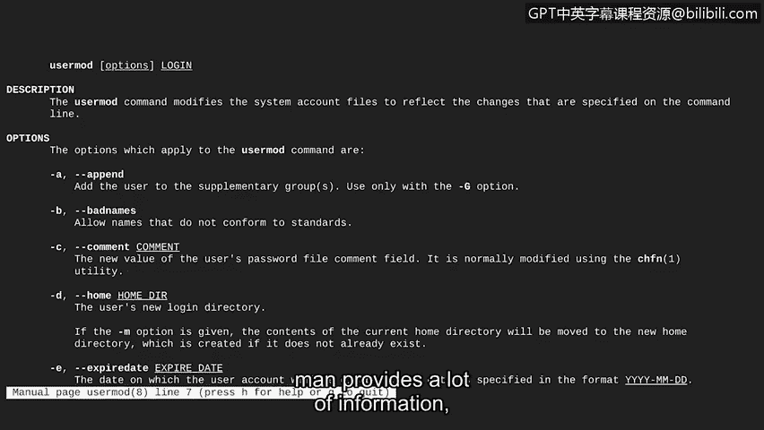
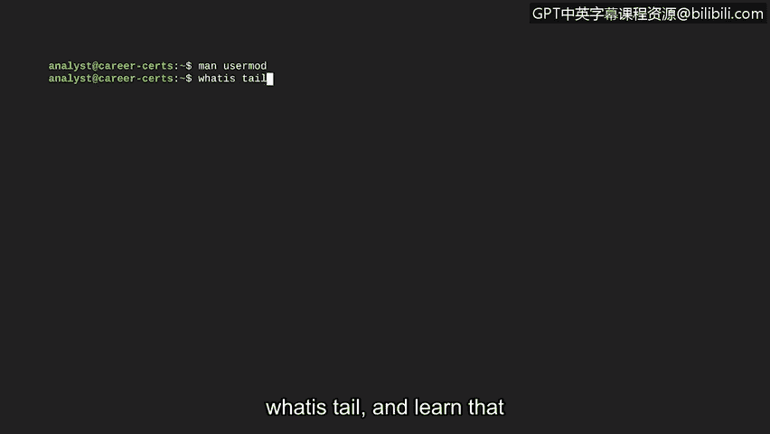
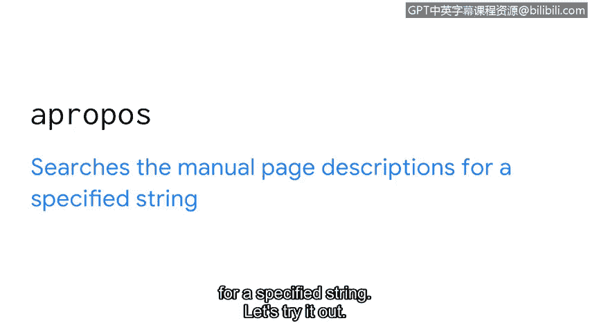
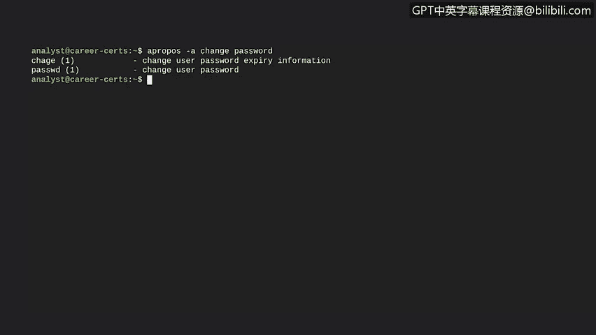

# 谷歌网络安全专业证书第四课：《工具之道：Linux与SQL》（中英字幕，前面分p中字，后面分p英字） - P71：28_03_man-pages-within-the-shell.en_subtitled - GPT中英字幕课程资源 - BV1tm4y1x74y

Welcome back。In this video， we're going to discuss some resources that are available directly through the shell and can help you while working in Linux。

One of the great things about Linux is that you can get help right through the command line。

The first command that can help you in this way is man。

Man displays information on other commands and how they work。

The name of this command comes from the word manualual。

Let's examine this more closely by using Man to get information about the user mod command。After man。

 we type the name of this command。The information that man returns includes a general description。

 It also contains information about each of user mod's options。 For example。

 the option dash D can be added to user mod to change a user's home directory。

 Man provides a lot of information。 But sometimes we just need a quick reference on what a command does。

In that case， you use what is， what is displays a description of a command on a single line。

Let's say you heard a coworker mention a command like Ta。You've never heard of this command before。

But you can find out what it does。Simply use the command what is Ta and learn that it outputs the last part of files。

Sometimes we might not even know what command to look up。 This is where Apropo can help us。

 Apropo searches the manual page descriptions for a specified string。 Let's try it out。

 Let's say you have a task that requires you to change a password。

 but you're not quite sure how to do this。 If we use the Apropo command with the string password。

 This will display a large number of commands with that word。 This helps somewhat。

 but it still may be difficult to find what we need。

 but we can filter this by adding the dash a option and an additional string。

 This option will return only the commands that contain both strings。 In our case。

 since we want to change the password。 Let's look for commands with both change and password。 Now。

 the Apo has been limited to the most relevant commands。

 These commands make it a lot easier to navigate the Linux command line。

As a new analyst， you won't have all the answers all the time， but you can learn where to find them。

