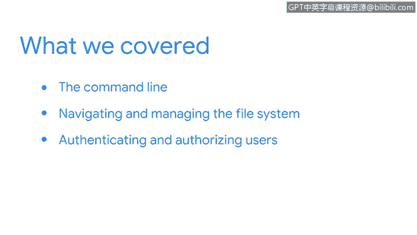

# 谷歌网络安全专业证书第四课：《工具之道：Linux与SQL》（中英字幕，前面分p中字，后面分p英字） - P72：29_01_wrap-up.en_subtitled - GPT中英字幕课程资源 - BV1tm4y1x74y

Congratulations， you completed another section in this course。

 Take a minute to think about what you achieved。 You learned a lot in this section。😊。

Let's recap what we covered。In this section， you utilize the command line to communicate with the O。

 Part of this was using commands for navigating and managing the file system。

 and you use other commands for authenticating and authorizing users。

These are all tasks that a security analyst is likely to encounter。 Finally。

 you learned about accessing resources that support learning new Linux commands。 With this knowledge。

 you'll be able to continue learning more and more about using the command line。 We did it。😊。

We learn how to communicate with Linux。 That's a great accomplishment。

 and one that will be very useful to you in your career as a security analyst。😊。

You should be proud of the work that you've done so far。

