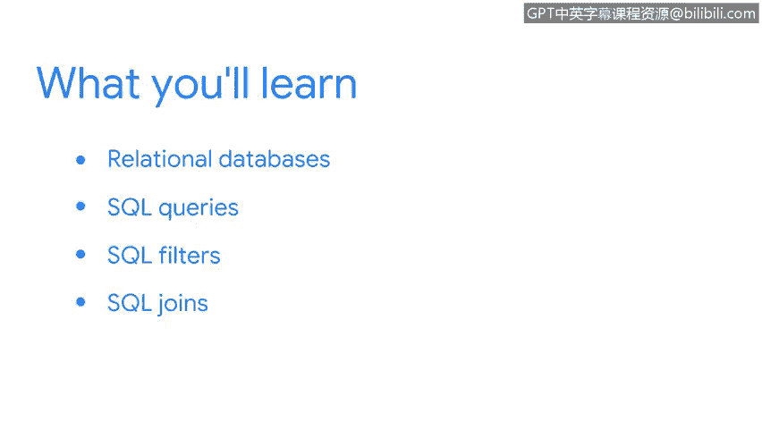

# 谷歌网络安全专业证书第四课：《工具之道：Linux与SQL》（中英字幕，前面分p中字，后面分p英字） - P73：30_01_welcome-to-week-4.en_subtitled - GPT中英字幕课程资源 - BV1tm4y1x74y

In the world of security， diversity is important。Diverse perspectives are often needed to find effective solutions。

 This is also true of the tools we use。 Your job will often require you to use a lot of diverse tools。

 In the last section， we study the Linux command line and learn how this tool can help you search and filter through data。

 navigate through the Linux file system and authenticate users。Now。

 we'll learn about another tool in this section， we'll explore SQL and how it allows you to analyze data in a way needed for your role as a security analyst。

 We're going to start off by learning about relational databases and how they're structured。

From there， we're going to introduce SQL queries and how to use them to access data from databases。

We then move on to SQL filters， which help us refine our queries to get the exact information we need。

Lastly， we'll explore explore SQL joins， which allow you to combine tables together。

When I'm presented with a problem or a project at work。

 I often have to sift through a large amount of data When I use SQL。

 I'm able to review data quickly and provide results with confidence since the queries are consistent and easily executed。

SQL is a very powerful and flexible tool Throughout this section。

 you'll learn how to use the parts of it you need as a security analyst and gain hands on experience。

 Good luck， and I'll join you for the rest of the course。😊。

