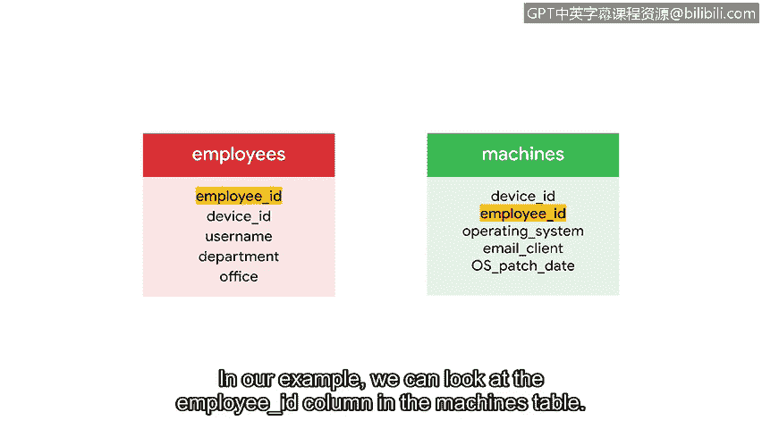

# 谷歌网络安全专业证书第四课：《工具之道：Linux与SQL》（中英字幕，前面分p中字，后面分p英字） - P74：31_02_introduction-to-databases.en_subtitled - GPT中英字幕课程资源 - BV1tm4y1x74y

Our modern world is filled with data， and that data almost always guides us in making important decisions。

 When working with large amounts of data， we need to know how to store it。

 So it's organized and quick to access and process。 The solution to this is through databases。

 And that's what we're exploring in this video。😊，To start us off。

 we can define a database as an organized collection of information or data。

Databases are often compared to spreadsheets。 Some of you may have used Google Sheets or another common spreadsheet program in the past。

 While these programs are convenient ways to store data。

 Spsheets are often designed for a single user or a small team to store less data。In contrast。

 databases can be accessed by multiple people simultaneously and can store massive amounts of data。

Databases can also perform complex tasks while accessing data。As a security analyst。

 you'll often need to access databases containing useful information， for example。

These could be databases containing information on login attempts， software and updates。

 or machines and their owners。Now that we know how important databases are for us。

 let's talk about how they're organized and how we can interact with them。

Using databases allow us to store large amounts of data while keeping it quick and easy to access。

There are lots of different ways we could structure a database， but in this course。

 we'll be working with relational databases。A relational database is a structured database containing tables that are related to each other。

Let's learn more about what makes a relational database。

 We'll start by examining an individual table in a larger database of organizational information。

Each table contains fields of information。 For example， in this table on employees。

 these would include fields like employee ID， device ID and username。

These are the columns of the tables。In addition， tables contain rows， also called records。

Rs are filled with specific data related to the columns in the table。 For example。

 our first row is a record for an employee whose I D is 1000 and who works in the marketing department。

 relationlational databases often have multiple tables。

Consider an example where we have two tables from a larger database。

 one with employees of the company and another with machines given to those employees。

 we can connect two tables if they share a common column In this example。

 we establish a relationship between them with a common employee I D column。

 The columns that relate two tables to each other are called keys。 There are two types of keys。

The first is called a primary key， the primary key refers to a column where every row has a unique entry。

The primary key must not have any duplicate values or any null or empty values。

 The primary key allows us to uniquely identify every row in our table。For the table of employees。

 employee ID is a primary key。Every employee ID is unique。

 and there are no employee IDs that are duplicate or empty。The second type of key is a foreign key。

 The foreign key is a column in a table that is a primary key in another table。Foreign keys。

 unlike primary keys， can have it empty values and duplicates。

The foreign key allows us to connect two tables together。 In our example。

 we can look at the employee ID column in the machines table。

We previously identified this as the primary key in the employees table。

 so we can use this to connect every machine to their corresponding employee。

It's also important to note that a table can only have one primary key， but multiple foreign keys。

With this information， we're ready to move on to the basics of SQL。

 the language that lets us work with databases Throughout this section。

 we'll gain hands on experience working with the concepts we just covered。😊。

