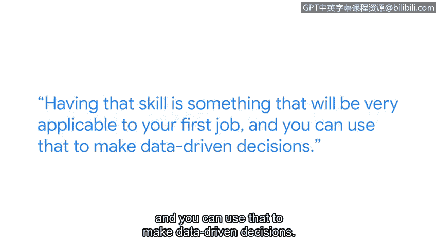

# 谷歌网络安全专业证书第四课：《工具之道：Linux与SQL》（中英字幕，前面分p中字，后面分p英字） - P76：33_05_adedayo-sql-in-cybersecurity.en_subtitled - GPT中英字幕课程资源 - BV1tm4y1x74y

。

Hi， my name is A Dio， and I'm a security engineer at Google。

 A lot of people think you need to have a degree in computer science， right。

 to be able to get into cybersecurity。 I don't think that's true。 Take me for an example。

 I started learning I T from。😊，Lagoos， Nigeria， where I was born and raised and then I'm all the way here now in Silicon Valley working for Google and I think that's just amazing and the dream come true you taking this certificate is a first step to you making a commitment to switching your career to cybersecurity so kudos to you and that。

SQL is one of the skill set you need to have in your toolbox as a cybersecurity professional because you can very quickly make decisions not just of the bad。

 but make decisions with data backing you and be able to communicate with your team with stakeholders about why you made a decision because it's one thing to be able to say。

We need to do this， right It's another thing to say。 we need to do this。

 And here's the data that I wrote my SQL statements about。

 I learned SQL by first as a coursework in school that was really great。

 But I think I kind of forgot everything about that after school the next step that I took was taking online courses。

 such as when you're taking right now to learn SQL and the fundamentals about it and how to really use it。

 And then the first time I used SQL practically was like Google。😊，You really need to practice。

 I think with anything else practice makes perfect right so being able to even if it's just a few hours a week。

 put aside time to practice writing sQel statement having that skill is something that will be very applicable to your first job and you can use that to make data driven decisions I feel very fulfilled working in cybersecurity。

 I feel very energized come into work every day， not only because I get to work on really complex problems and try to figure solutions for them。

 but I also have great timates that we all come together and tackle the problem then able to go to bed at night knowing that the work that I do is for the better of Google users and Google employees is a very rewarding feeling for me。

