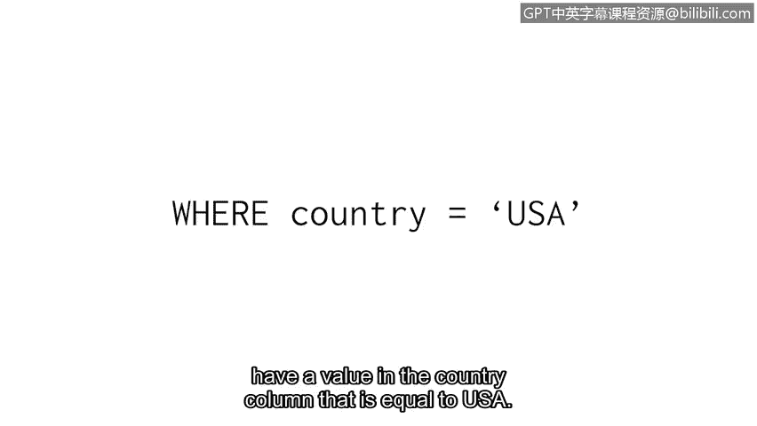
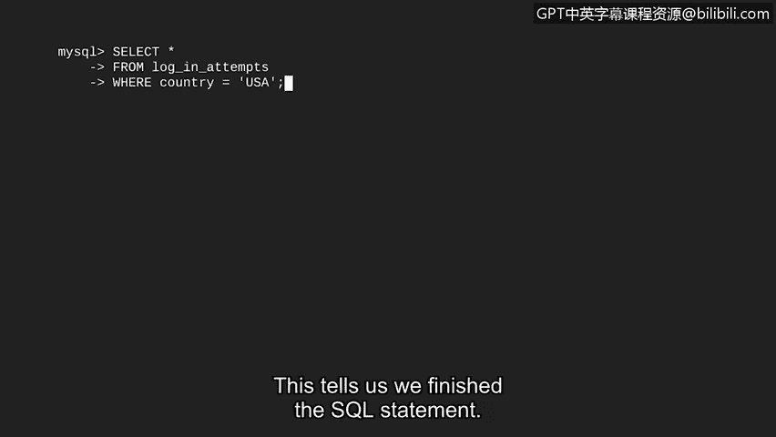
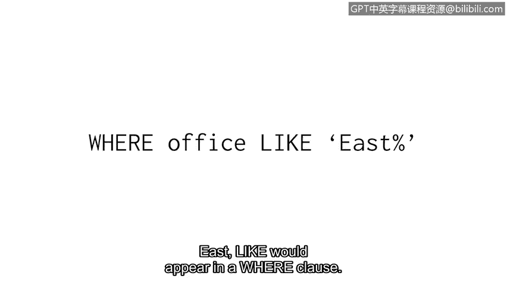
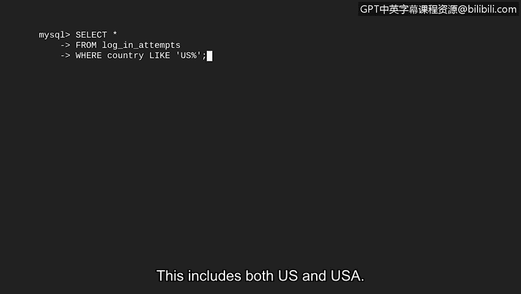

# 谷歌网络安全专业证书第四课：《工具之道：Linux与SQL》（中英字幕，前面分p中字，后面分p英字） - P78：35_04_basic-filters-on-sql-queries.en_subtitled - GPT中英字幕课程资源 - BV1tm4y1x74y

One of the most powerful features of SQL is its ability to filter。In this video。

 we're going to learn how this helps us make better queries and select more specific pieces of data from a database。

 Filtering is selecting data that match a certain condition。

 Think of filtering as a way of only choosing the data we want。

 Let's say we wanted to select apples from a fruit cart。

 Fing allows us to specify what kind of apples we want to choose。 When we go by apples。

 we might explicitly say， choose only apples that are fresh。

 This removes apples that aren't fresh from the selection。 This is a filter。😊，As a security analyst。

 you might filter a login attempts table to find all attempts from a specific country。

This could be done by applying a filter on the country column。For example。

 you could filter to just return records containing Canada。 Before we get started。

 we need to focus on an important part of this syntaxis SQL。Let's learn about operators。

An operator is a symbol or key word that represents an operation。

An example of an operator would be the equal to operator。 For example。

 if we wanted to find all records that have USA in the country column， we use country equals USA。

To filter a query in SQL， we simply add an extra line to the select and from statement we used before。

 This extra line will use a where clause in SQL， where indicates the condition for a filter。

After the key word， where the specific condition is listed using operators。

 So if you wanted to find all of the login attempts made in the United States。

 we would create the filter in this particular condition。

 We indicating to return all records that have a value in the country column that is equal to USA。

Let's try putting it all together in SQL。 We're going to start with selecting all the columns from the log underscore in underscore Atemp table。

And then add the War filter。Don't forget the semicolon。This tells us we finished the SQL statement。

 Now， let's run this query。

Because of our filter， only the rows where the country of the login attempts was USA are returned。

In the previous example， the condition for our filter was based simply on returning records that are equal to a particular value。

We can also make our conditions more complex by searching for a pattern instead of an exact word。

For example， in the employee table， we have a column for office。

We could search for records in this column that match a certain pattern。

Perhaps might want all offices in the east building to search for a pattern。

 we uses a percentage sign to act as a wild card for unspecified characters。

 If we ran a filter for east percentage sign。😊，This would return all records that start with East。

 for example， the offices East 120， East 290 and East 435。

When searching for patterns with the percentage sign， we cannot use the equals operator。Instead。

 we use another operator， like。Like is an operator used with where to search for a pattern in a column。

Since like is an operator， similar to the equal sign， we use it instead of the equal sign。

So when our goal is to return all values in the office column， best start with the word east。

 like would appear in a where clause。

Let's go back to the example in which we wanted to filter for login attempts made in the United States。

Imagine that we realize our database contains inconsistencies with how the United States is represented。

Some entries use US， while others use USA。Let's get into is equalQL and apply this new type of filter with like。

We're going to start with the same first two lines of code because we want to select all columns from the login Attemps table。

And we're going to add a filter with like so that records will be returned if they contain a value in the country column beginning with the characters US。

 This includes both US and USA。

Let's run this query to check if the output changes。

This returns all the entries where the user location was in the United States。

And now we can use the like clauses to filter columns based on a pattern。 Wow。

 we've already learned how to get very precise with our database and get exactly the data we need with one single query。

😊，I'm excited for what's next。

