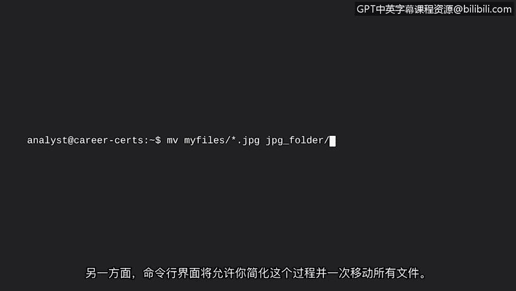

# 谷歌网络安全专业证书第四课：《工具之道：Linux与SQL》（中英字幕，前面分p中字，后面分p英字） - P7：6_图形用户界面（GUI）与命令行界面（CLI）.zh - GPT中英字幕课程资源 - BV1tm4y1x74y

Now that you've learned the inner workings of computers。

 let's discuss how users and operating systems communicate with each other。So far。

 you've learned that a computer has an operating system， hardware and applications。Remember。

 the operating system communicates with the hardware to execute tasks。In this video。

 you'll learn how the user， that's you， interacts with the operating system in order to send tasks to the hardware。

The user communicates with the operating system via an interface。

A user interface is a program that allows a user to control the functions of the operating system。

Two user interfaces that we'll discuss are the graphical user interface or GuI and the command line interface or CLI。

Let's cover these interfaces in more detail。AguoI is a user interface that uses icons on the screen to manage different tasks on the computer。

 Most operating systems can be used with a graphical user interface。

If you've used a personal computer or a cell phone， you have experience operating a goUI。

Most GooIs include these components， a start menu with program groups。

 a taskbar for launching programs， and a desktop with icons and shortcuts。

All these components help you communicate with the OS to execute tasks。

In addition to clicking on icons， when you use a GuUI。

 you can also search for files or applications from the start menu。

You just have to remember the icon or name of the program to activate an application。Now。

 let's discuss the command line interface In comparison。

 the command line interface or CLI is a text based user interface that uses commands to interact with the computer。

These commands communicate with the operating system and execute tasks like opening programs。

The command line interface is a much different structure than the graphical user interface。

 When you use a CI， you'll immediately notice a difference。

There are no icons or graphics on the screen。 The command line interface looks similar to lines of code using certain text languages。

A CLI is more flexible and more powerful than a GuUi。

 Think about using a CI like creating whatever meal you'd like from an ingredient spot at a grocery store。

This gives you a lot of control and customization about what you're going to eat。In comparison。

 using the Gui is more like ordering food from a restaurant。You can only order what's on the menu。

If you want both a noodle dish and pizza， but the first restaurant you go to only has pizza。

 you'll have to go to another restaurant to order the noodles。

With a graphical user interface， you must do one task at a time。

 but the command line interface allows for customization。

 which lets you complete multiple tasks simultaneously。 For example。

 imagine you have a folder with hundreds of files of different file types。

 and you need to move only the JPEG files to a new folder。

Think about how slow and tedious this would be as you use a GuUI to find each JPEG file in this folder and move it into the new one。

On the other hand， the CLI would allow you to streamline this process and move them all at once。

As you can see， there are very big differences in these two types of user interfaces As a security analyst。

 some of your work may involve command line interface when analyzing logs or authenticating and authorizing users。

 security analysts commonly use a CI in their everyday work。😊，In this video。

 we discuss two types of user interfaces you learn that you already have experience using a graphical user interface as most personal computers and cell phones use a GuUI。

And you were introduced to the command line interface。Later in the program。

 you'll learn how to use a CLI in Linux and how relevant it is to your daily work as a security analyst。

You'll get practical experience communicating through the command line， pretty exciting， right？

