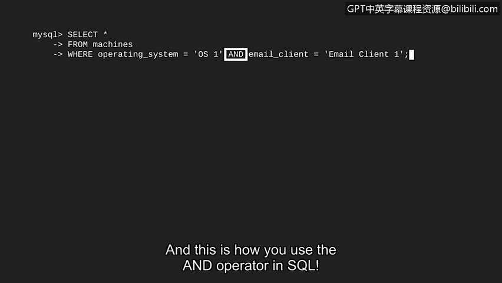
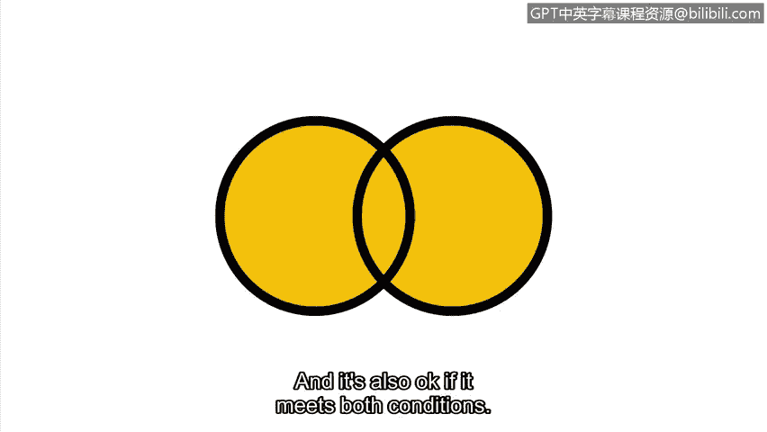
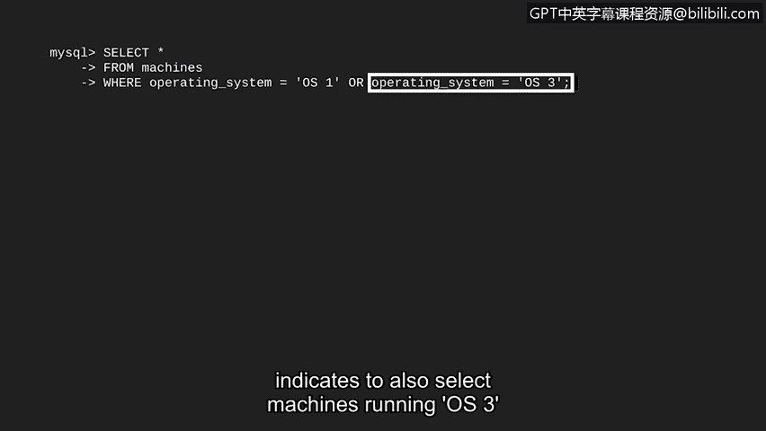
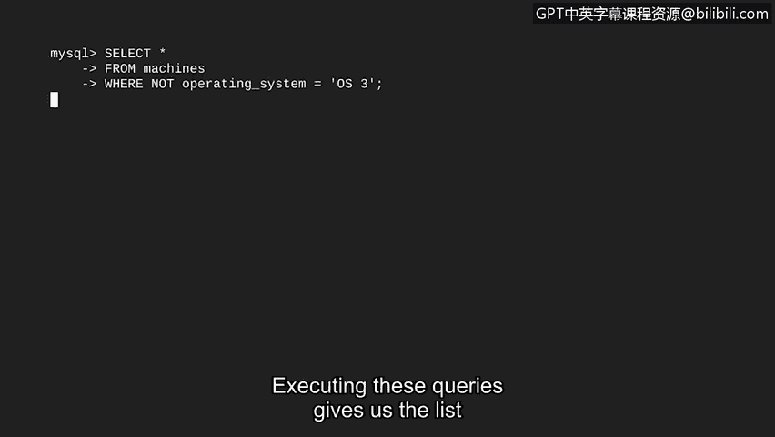

# 谷歌网络安全专业证书第四课：《工具之道：Linux与SQL》（中英字幕，前面分p中字，后面分p英字） - P80：37_03_filters-with-and-or-and-not.en_subtitled - GPT中英字幕课程资源 - BV1tm4y1x74y

In the previous lesson， we learned about even more ways to filter queries in SQL to work with some typical security analyst tasks。

However， when working with real security questions， we often have to filter for multiple conditions。

 vulnerabilities， for instance， might depend on more than one factor。For example。

A security vulnerability might be related to machines using a specific email client on a specific operating system。

So to find the possible vulnerabilities。We need to find machines using both the email client and the operating system。

To make a query with multiple conditions that must be met。

 we use the and operator between two separate conditions。

And is an operator that specifies that both conditions must be met simultaneously。

Bringing this back to our fruit and vegetable analogy。

 This is the same as asking someone to select apples from the big box where the apples are large and fresh。

This means our results won't include any small apples， even if they're fresh or any rotten apples。

 even if they're large。Theyll only include large fresh apples。 The apples must meet both conditions。

Going back to our database， the Mas table lists all operating systems and email clients。

We want a list of machines running operating system 1 and a list of machines using email clientient1。

We'll use the leftptimized circles in the Venn diagram to represent these groups。

We need SQL to select the machines that have both OS1 and email clientient1。

The fill in area at the intersection of these circles represents this condition。

Let's take this and implement it in SQL。

First， we're going to start by building the first lines of the query。

 telling SQL to select all columns from the Ma table。Then we'll add the wear clauses。

Let's examine this more closely。First， we indicate the first condition that it must meet。

 that the operating system column has a value of O S1。

Then we use an to join this to another condition。And finally。

 we enter that other condition in this case， that the email client column should have a value of email client1。

And this is how you use the and operator in SQL。

Let's run this to get the query results。Perfect， all the results match both our conditions。

Let's keep going and explore more ways to combine different conditions by working with the or operator。

The orR operator is an operator that specifies that either condition can be met。In a Ven diagram。

 let's say each circle represents a condition。 When they are adjo with or。

 SQL would select all rows that satisfy one of the conditions。

And it's also okay if it meets both conditions。

Let's run another query and use the or operator。Let's say that we wanted the filter to identify machines that have either OS1 or OS3。

 because both types need a patch。 We'll type in these conditions。Let's examine this more closely。

 After where our first condition indicates we want to filter so that the query selects machines with O S1。

We use the orR operator because we also want to find records that match another condition。

This additional condition is placed after or and indicates to also select machines running OS3。

Executing the query， our results now include records that have a value of either OS1 or OS3 in the operating system column。

Good job。 We're running some complex queries。 The last operator we're going to go into is a not operator。

😊，Not negates the condition。In a diagram， we can show this by selecting every entry that does not match our condition。

 The condition is represented by the circle。 The filled in portion outside the circle represents what gets returned。

 This is all data that does not match the condition。For example， when picking out fruit。

 you could be looking for any fruit that is not an apple。

That is a lot more efficient than telling your friend you want a banana or an orange or a lime and so on。

Suppose you wanted to update all the devices in your company except for the ones using OS3。

Bringing this into SQL， we can write this query。We place not after where and before the condition of the filter。

Executing these queries gives us the list of all the machines that aren't running OS3。

 and now we know which machines to update。

That was a lot of new content that we just looked into。

 but you're learning more and more SQL that you can use on your journey to become an analyst。

In the next video， we'll be learning how to combine and join two tables together to expand the kinds of queries we can run。

 I'll meet you there。