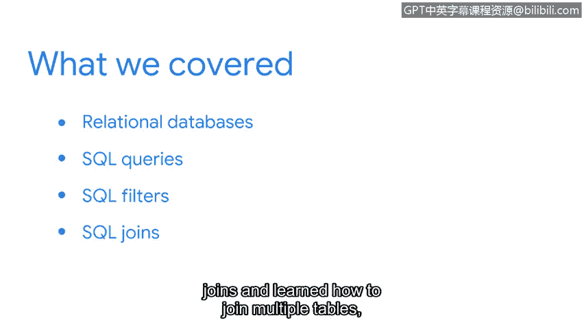

# 谷歌网络安全专业证书第四课：《工具之道：Linux与SQL》（中英字幕，前面分p中字，后面分p英字） - P83：40_01_wrap-up.en_subtitled - GPT中英字幕课程资源 - BV1tm4y1x74y

Congratulations， we've made it together through the end of our focus on SQL。😊。

You've put in a lot of work and learned an important tool that will help you on your journey as a security analyst。

Let's take a moment to go through all of the topics you learned in this section。

 We started by learning about the structure of relational databases and how we can access them by using the query language SQL。

We then got hands on practice with writing our own SQL queries。

 We use SQL to bring up information you might need on the job when working as an analyst。

We then focused on SQL filters。 We started with simple conditions with strings。 And by the end。

 we learned how to use multiple filters in one query。

 We concluded the unit with SQL joins and learned how to join multiple tables。

 giving us even more information at once。😊。

By completing this course， you just took a very big step in your future career as a security analyst。

You have been introduced to a powerful tool that can help you in your work， and whenever you need to。

 I encourage you to revisit the materials in this course。

 learning a querying language like SQL takes time。Thank you again for joining me in this journey。

 I hope you will enjoy using SQL as much as I do。😊。

