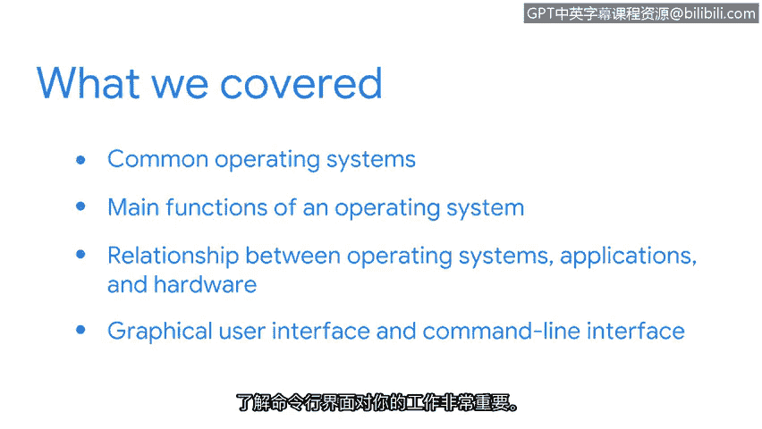

# 谷歌网络安全专业证书第四课：《工具之道：Linux与SQL》（中英字幕，前面分p中字，后面分p英字） - P9：8_总结.zh - GPT中英字幕课程资源 - BV1tm4y1x74y

We did it。 What a great section of learning。 The best thing is that we did this together and covered some very useful topics。

 Let's recap this section's lessons。😊，As a security analyst。

 it's important that you understand the systems that you're working with。

Understanding computer basics will help you do your job more effectively and efficiently。

 In this section， we covered common operating systems。

We also discussed the main functions of an operating system。 Importantly。

 you learn about the relationship between operating systems， applications and hardware。

 It was nice to learn how they flow together like an orchestra。 In addition。

 you learn about the differences between the graphical user interface and the command line interface。

 Understanding the command line interface will be very important for your work。😊。

I enjoyed exploring the world of operating systems with you。

 Knowing how operating systems work is an important step in preparing for a position as a security analyst。

 You are doing great。😊，Let's keep moving forward with this program。In the next section。

 we'll focus specifically on the Linux operating system。

