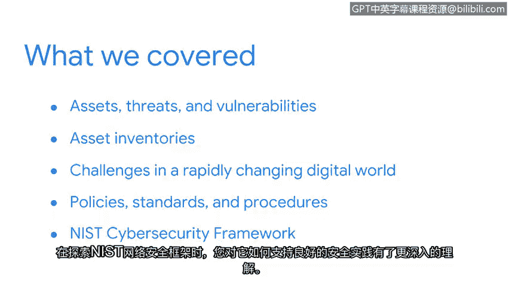

# 谷歌网络安全专业证书第五课：《资产、威胁和漏洞》（中英字幕，前面分p中字，后面分p英字） - P10：9_总结.zh - GPT中英字幕课程资源 - BV1QM4y1H7sh

Well done。 You made it to the end of this section。 Being a security practitioner takes commitment and a desire to learn。

😊，A big part of the job involves keeping current with best practices and emerging trends。

Thinking back on my own journey into the world of security。

 I'm so proud of you for your continued commitment。😊，We've covered a lot of material this week。

 And this is a good time to reflect and look back on the key concepts we explore together。😊。

We covered the building blocks of organizational risk management， assets。

 threats and vulnerabilities。 We also spent some time demonstrating the importance of asset inventories。

 It's much easier to protect company' assets if you know where they are and who's responsible for them。

After that， we moved on to explore the challenges in a rapidly changing digital world。

 Part of protecting data in this world is understanding if it's in use in transit or at rest。😊。

Finally， in our high level exploration of policies， standards and procedures。

 we talked about how each of them factor into achieving security goals。😊。

There is no one size fit all approach to achieving security。

While exploring the NIS cybersecurity framework， you gain an appreciation of how it supports good security practices。

😊。

Attackers are also constantly building their skills and finding new ways to break through the defenses we put up。

 Remember， the landscape is always changing。 There's always more to learn if you want to be a good security practitioner。

 Next up， we're going to expand our security mindset。 by learning more about the different system。

 security teams used to protect organizational assets。 I'm looking forward to it。😊。

