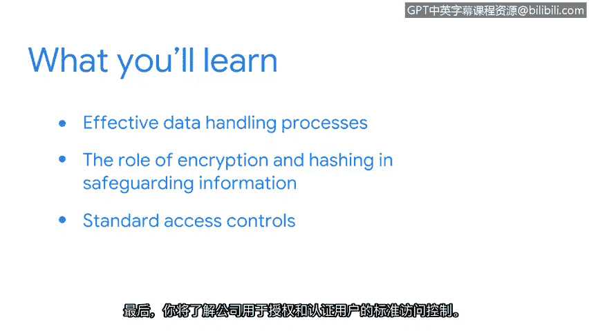

# 谷歌网络安全专业证书第五课：《资产、威胁和漏洞》（中英字幕，前面分p中字，后面分p英字） - P11：10_欢迎来到第二周.zh - GPT中英字幕课程资源 - BV1QM4y1H7sh

I was fascinated by a world Ma World event that happened in 2017。

 I started watching videos and preparing to take certification tests， just like you。

 I felt overwhelmed at first， but my curiosity and passion has driven me to continue learning in this field。

 I always remind myself that no one is born knowing everything and everyone one is on a learning journey。

 Even now， I still remember what it was like to start out in this profession。 So believe me。

 when I tell you that you're making great progress。 and I am proud of your effort。😊，Now。

 before looking ahead to where we're headed on our journey into the world of security。

 let's take a moment to look back on where we've been。Previously。

 we focused mostly on the concept of assets and risks and security。

 We cover topics like the importance of managing assets and keeping them safe。

We discuss how the digital world presents new challenges and opportunities in the field of security。

 We also spent some time exploring security plans with this solid foundation。

 We're ready to keep expanding our security mindset。😊，In this section。

 well cover the security controls that are used to proactively keep assets safe。

I use the word proactively there on purpose。 As youll soon discover。

 these controls are the protections that we put in place to stop problems before they happen。

We're going to begin by taking an indep look at privacy。Here。

 you'll learn about the effective data handling processes that keep information safe。 Next。

 you'll explorer the role of encryption and hashing and safeguarding information。😊，Finally。

 you will learn about the standard access controls that companies use to authorize and authenticate users。

😊。

Alright， are you ready to keep moving ahead， I know I am。

