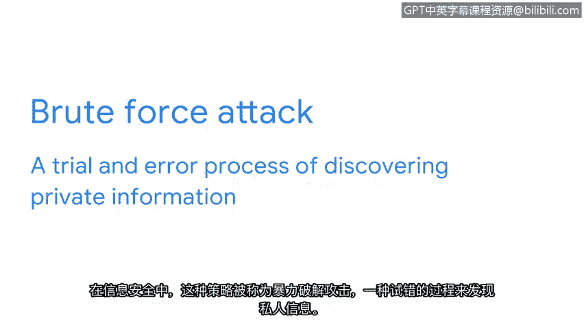

# 谷歌网络安全专业证书第五课：《资产、威胁和漏洞》（中英字幕，前面分p中字，后面分p英字） - P15：14_加密基础知识.zh - GPT中英字幕课程资源 - BV1QM4y1H7sh

The Internet is an open public system with a lot of data flowing through it。

 Even though we all send and store information online。

 there is some information that we choose to keep private in security。

 This type of data is known as personally identifiable information。

Personally identifiable information or PII is any information that can be used to infer an individual's identity。

 This can include things like someone's name， medical and financial information， photos。

 emails or fingerprints。Maintaining the privacy of P II online is difficult。

 It takes the right security controls to do so。One of the main security controls used to protect information online is cryryptography。

 Cryptography is the process of transforming information into a form that unintended readers can't understand。

Data of any kind is kept secret using a two step process。

 encryption to hide the information and decryption to unhide it。Imagine sending an email to a friend。

The process starts by taking data in its original and readable form known as plain text。

 Ecryption takes that information and scrambles it into an unreadable form known as ciphert。

We then use decryption to unscramble the cipher text back into plain text form。

 making it readable again， hiding and unhiding private information is a practice that's been around for a long time。

 way before computers。One of the earliest cryptographic methods is known as Caesar Cypher。

 This method is named after a Roman general， Julius Caesar。

 who ruled the Roman Empire near the end of the1s century。 B， C。

 He used it to keep messages between him and his military general's private。

 Caesar Cypher is a pretty simple algorithm that works by shifting letters in the Roman alphabet forward by a fixed number of spaces。

😊，An algorithm is a set of rules that solve a problem。Specifically in cryptography。

 a cipher is an algorithm that encrypts information。For example。

A message encoded with Caesar cipher using a shift of three would encode an A as a D and A B as an E。

 A C， as an F and so on。In this example， you could send a friend a message that said， hello。

 using a shift of three， and it would read K， H， O， O R。Now， you might be wondering。

 how would you know the shift a message encrypted with Caesar Cypher is using。The answer to that is。

 you need the key。 A cryptractic key is a mechanism that decryptps cpherts。In our example。

 the key would tell you that my message is encrypted by three shifts。 With that information。

 you can unlock the hidden message。 Every form of encryption relies on both a cipher and key to secure that change of information。

Caesar cipher is not widely used today because of a couple of major flaws。

One concerns the cipher itself。 The other relates to the key。

This particular cipher relies entirely on the characters of the Roman alphabet to hide information。

 For example， consider a message written using the English alphabet， which is only 26 characters。

 Even without the key， it's pretty simple to crack a message secured with Caesar cipher by shifting letters 26 different ways。

In information security， this tactic is known as brute force attack。

 a trial and error process of discovering private information。

The other major flaw of Caesar cipher is that it relies on a single key。

 If that key was lost or stolen， there is nothing stopping someone from accessing private information。

Properly keeping track of crypttic keys is an important part of security。To start。

 it's important to ensure that these keys are not stored in public places and to share them separately from the information they will decrypt。

Caesar cipher is just one of many algorithms used to protect people's privacy。Due to its limitations。

 we rely on more complex algorithms to secure information online。

Our next focus is exploring how modern algorithms work to keep information private。

