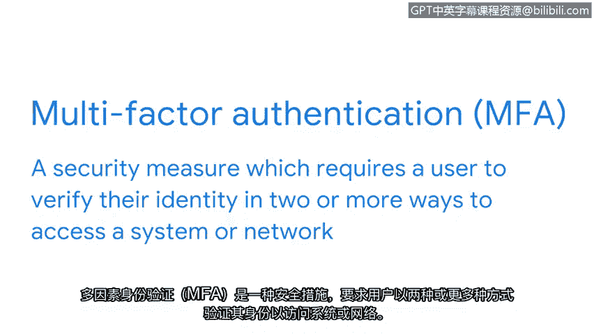

# 谷歌网络安全专业证书第五课：《资产、威胁和漏洞》（中英字幕，前面分p中字，后面分p英字） - P18：17_访问控制和认证系统.zh - GPT中英字幕课程资源 - BV1QM4y1H7sh

Protecting data is a fundamental feature of security controls。

 When it comes to keeping information safe and secure， hashing and encryption are powerful。

 yet limited tools。Managing who or what has access to information is also key to safeguarding information。

The next series of controls that we'll be exploring are access controls。

 the security controls that manage access， authorization and accountability of information。

 When done well， access controls maintain data confidentiality， integrity and availability。

 they also get users the information they need quickly。

These systems are commonly broken down into three separate yet related functions known as the authentication。

 authorization and accounting framework。Each control has its own protocol and systems that make them work。

In this video， let's get comfortable with the basics of the first one on the list。 Aation。

 authentication systems are access controls that serve a very basic purpose。

 They ask anything attempting to access information。 this simple question。😊，Who are you。

 Organizations go about collecting answers to these questions differently。

 depending on the objectives of their security policy。Some are more thorough than others。

 but in general， responses to this question can be based on three factors of authentication。

 The first is knowledge。 Aation by knowledge refers to something the user knows like a password or the answer to a security question they provided previously。

Another factor is ownership， referring to something the user possesses。

A commonly used type of authentication by ownership is a one time passcode or O TP。

 You' probably experienced these at one time or another。

They' are a random number sequence that an application or website will send you via text or email and ask you to provide。

 Last is characteristic。 Authentation by this factor is something the user is。

Biometrics like fingerprint scans on your smartphone are an example of this type of authentication。

 While not used everywhere， this form of authentication is becoming more common because it's much tougher for criminals to impersonate someone if they have to mimic a fingerprint or facial scan as opposed to a password。

The information provided during authentication needs to match the information on file for these access controls to work when the credentials don't match。

 authentication fails and access is denied when they match， access is granted。Incorrectly。

 denying access can be frustrating to anyone。To make access systems more convenient。

 many organizations these days rely on single signon。

 S signon or SSO is a technology that combines several different logins into one。😊。

Can you imagine having to reintroduce yourself every time you meet up with a friend。

That's exactly the sort problem SSO solves， instead of requiring users to authenticate over and over again。

 SSO establishes their identity once， allowing them to gain access to company resources faster。

While SSO systems are helpful when it comes to speeding up the authentication process。

 they present a significant vulnerability when used alone。

Denyying access to authorized users can be frustrating。 But you know， what's even worse。

Incorrectly granting access to the wrong user。S， S， O technology is great。

 but not if it relies on just a single factor of authentication。😊。

Adding more authentication factors strengthening these systems。

 multifactor authentication or MFA is a security measure which requires a user to verify their identity in two or more ways to access a system or network。

MFA combines two or more independent credentials like knowledge and ownership to prove that someone is who they claim to be。

S，S O and MFA are often used in conjunction with one another to layer the defense capabilities of authentication systems。

 When both are used， organizations can ensure convenient access that is also secure。

 Now that we cover authentication。 we're ready to explore the second part of the framework。 Next。

 we'll learn about authorization。😊。

