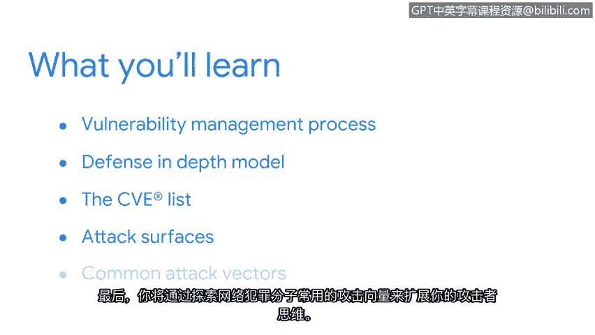

# 谷歌网络安全专业证书第五课：《资产、威胁和漏洞》（中英字幕，前面分p中字，后面分p英字） - P23：22_欢迎来到第三周.zh - GPT中英字幕课程资源 - BV1QM4y1H7sh

Wow， we've covered a lot together。 It's hard to believe we reached the midpoint of this course。

 I hope you're getting a clearer picture of this exciting fill and all the opportunities it has to offer。

 And most importantly， I hope you're having fun doing it。😊。

We've come a long ways from where we started。When we began our journey together。

 we were introduced to the three building blocks of every security program。 As。

 threats and vulnerabilities。 We focused a lot on assets early on。 and the wide range of things。

 security professionals work to protect。 We then turned our attention to a core component of asset security。

 protecting assets。 You learned about the importance of garden sensitive information。

 You also learned about some security controls that protect information from being lost or stolen。😊。

On the next part of our journey， we're going to turn our focus to vulnerabilities。

 Every asset we protect has a series of vulnerabilities or flaws that we need to be aware of。

 Staying informed of these things is a critical part of protecting people and organizations from harm In this next part of the course。

 you will gain an understanding of the vulnerability management process。 First。

 you will explore a common approach to vulnerability management。 The defense and depth model。😊。

Then you will learn about how vulnerabilities are documented in online libraries like the CV E lists。

 We'll discuss the attack surfaces security teams protect。 And lastly。

 you will expand your attacker mindset by exploring the common attack vectors cyber criminalmins try to exploit。

Security analysts play an important role in identifying and correcting vulnerabilities and systems。

 I know I'm excited to keep exploring。 Are you， Then let's go。

