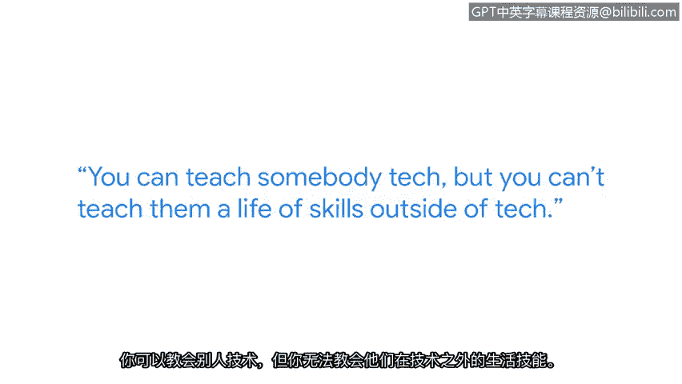

# 谷歌网络安全专业证书第五课：《资产、威胁和漏洞》（中英字幕，前面分p中字，后面分p英字） - P28：27_奥马德：我在网络安全中的学习之旅.zh - GPT中英字幕课程资源 - BV1QM4y1H7sh

My name is Ohmad。 I'm a corporate operations engineer at Google。 All I do is solve problems。

 Googlers have problems。 They need somebody talk to。 usually talk to us。

 If you ask me at 18 years old， where I would be now。

 I would have never told you I'd be working as a security engineer。

 I would have told you I'd be working in a prison or I'd be working as a police officer。

 Some township and just working the regular 9 to5 shift after high school。

 I went on to work at Trenton State prisonson， which is the only maximum security prison in New Jersey。

 It was very stressful， but at the same time， it's what I wanted to do at the time。

 or at least that's what I thought I wanted to do at the time。

 five years after becoming a correction officer。 I took the test again to be a sheriff's officer。

 And on the last day of that academy。 I decided this wasn't for me。

 I was tired of being on my face doing pushups。 I was tired of being yelled at。

 I went home and I did what everybody else would do。 do a Google search。 And I saw one for Google。

 and was a residency program as the top of the list， and I applied to it as a choke。

 I even told my friends at the time I'm going apply to this。 I'm not gonna get in。

 I had no reference no connections。 I knew nobody that worked at Google。 And within a couple of days。

😊，C to reached out to me。 She said， think you're a great fit。 You're a career changer。

 I like your application。 I like your resume。 I think you'd be a great fit。

 All the interviews like my background。 They liked that I self taught a lot of interviews were able to relate to me。

 They said， hey， I did the same thing。 from there， I was offered the job and I started my career。

 When I was in orientation。 somebody right next to me was actually the valatorian of Princeton。

 Here I am with no college degree。 No exposure， no work experience。 and I'm in the same company。

 for career changers。 What you have that other people don't have is a different mindset。

 So you're coming from experience outside of the technical space that you can transfer into the technical space。

 Don't forget that we all have skill sets that can help you in the field。

 That's what employers are looking for。 That's what hiring managers are looking for。

 One thing I learned as correction officer is how to assess risk。 Every situation is different。

 Just like the security space。 Every risk is different。 Every vulnerability is different。

 Every threat is different。 You can teach somebody tech。

 You can't teach them a life of skills is outside of tech。 If I were to call back and。😊。

All my 18 year old self， one piece of advice。 it would be， don't be scared。 Do it。

 career in cybersecurity is very fun。 It's very interesting。 It will work your brain。 change my life。

 It'll change yours as well。