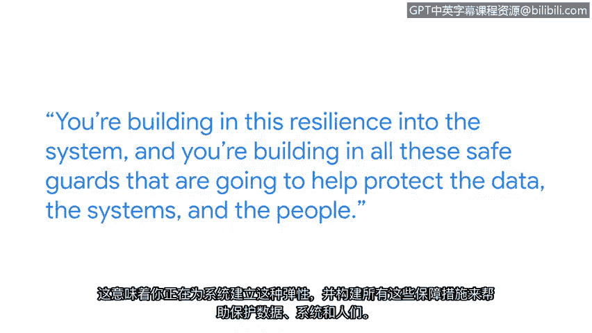

# 谷歌网络安全专业证书第五课：《资产、威胁和漏洞》（中英字幕，前面分p中字，后面分p英字） - P30：29_尼鲁：采用攻击者思维.zh - GPT中英字幕课程资源 - BV1QM4y1H7sh

。

Hi， I'm Niro and I lead the red team at Google。 The red team at Google simulates attackers that are trying to hack into Google。

 They function as a spaing partner for the blue team。 That is the teams that build security controls。

 detection pipelines or respond to incidents So we help test all of those by simulating adversaries So we hack into Google to make it harder to hack into Google So it's like。

 hey we found these issues with your system Now here are some recommendations we have and how can we help you fix this。

 thinking like an attacker is approaching a problem like an adversary？

 I generally have a predisposition to think like an attacker It started when I was a kid and I used to play video games and I used to ask do I have to beat the game in the way it's intended do I have to get the objective in the standard path looking at a system and asking the question。

 can I break into it？ how do I break into it， what is likely to fail if it。

What does that give me It's about taking apart systems and trying to understand it。

 Treadmoring is integral to almost anything a security professional does。

 It's about challenging assumptions。 It's about approaching things from a different perspective rather than looking at the system from the perspective of a developer who is thinking about how do I build the system in a way that it works for people you're putting on the hat of an attacker and saying if I look at the system。

 how would I break into it It's important for security professionals to think like an attacker because you code more defensively you build things more defensively and you break things more offensively and what that means is you're building in this resilience into the system and youre building in all these safeguard that are going to help protect the data。

 the systems and the people in order to build my attacker mindset What I did is I would go pick people's brains What that means is I can grab time with them and say。

 hey， how do you approach the system What are the。

Assumptions you're making。How do you build out the security safeguards that you're thinking about My advice for people who are trying to build it on attacker mindset is go talk to people be it in local meetups in conferences find yourself a CTF group and play these competitions with them see how each person in the team approaches certain things and salts for it almost everything we do on a daily basis is online these days like banking is online grocerycer shopping is online the electricity grid。

 be a water supplies。 all of this has happened in a shorts span of time and now people are taking a step back and say what does that mean for us and cybersecurity folks are the ones who help make sure these systems are locked down and protected against these adversaries if you're inquisitive if you like taking things apart if you like solving things if you want to help make things secure you should join cybersecurity。

