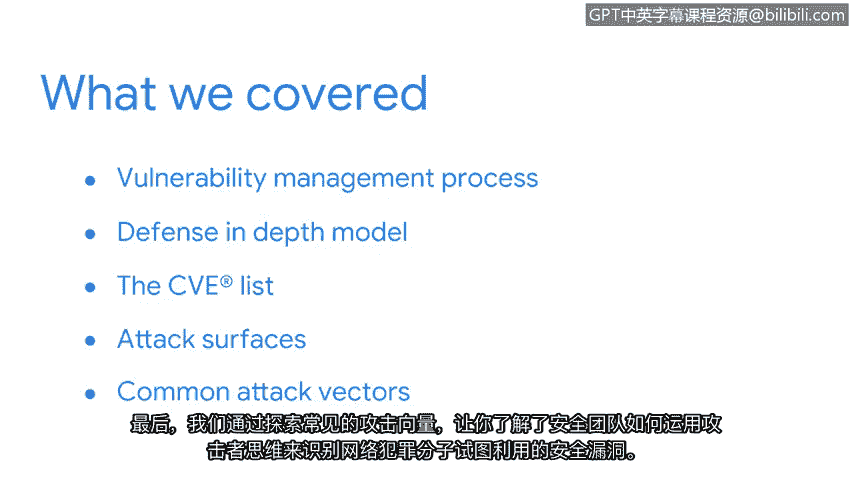

# 谷歌网络安全专业证书第五课：《资产、威胁和漏洞》（中英字幕，前面分p中字，后面分p英字） - P32：31_总结.zh - GPT中英字幕课程资源 - BV1QM4y1H7sh

Here we are at the end of this section。 Can you believe it。

 I had so much fun exploring the world of vulnerabilities。 I hope you felt the same。

 And more importantly， I hope you got a better sense of how complex a landscape the digital world is。

 This environment is filled with gaps that attackers can use to gain unauthorized access to assets。

 Ma it a challenge to defend。😊，We've explored a lot of information this time around。

 So let's quickly recap what we've covered。You've learned about the vulnerability management process。

 starting with the defense and depth model。You learned about the layers of this security framework and how each of them worked together to build a stronger defense。

 You then learned about the C the E list that she used to find cataloged vulnerabilities。

 This is a great addition to your growing security toolbox。😊，After that。

 you learned of the attack surfaces that businesses protect。

 We discussed physical and digital surfaces and the challenges of defending the cloud。😊。

We finished up by exploring common attack vectors where you learned how security teams use an attacker mindset to identify the security gaps that cyber criminals try to exploit。

 Every one of the vulnerabilities that we've discussed so far is faced with a number of threats。

 When we get back together， we're going to expand our attacker mindset even further by exploring specific type of attacks that cyber criminals commonly use。

 We'll look at things like malware and the techniques attackers use to compromise defense systems by exploring how these tools and tactics work。

 You'll gain a clear understanding of the threats they pose。

 We'll then wrap up by investigating how security teams stop these threats from damaging or organizations operations。

 their reputation and most importantly， their customers and employees。

 You've done a fantastic job getting to this point。 When you're ready。

 let's finish a journey together。 I'm looking forward to being back with you again。😊。

