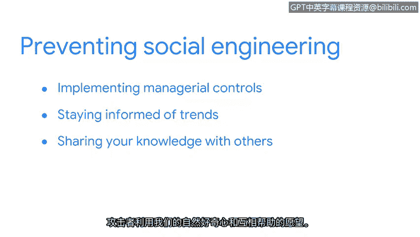

# 谷歌网络安全专业证书第五课：《资产、威胁和漏洞》（中英字幕，前面分p中字，后面分p英字） - P34：33_欺骗的犯罪艺术.zh - GPT中英字幕课程资源 - BV1QM4y1H7sh

When you hear the word cyber criminal， what comes to mind。

 You may imagine a hacker hunched over a computer in a dark room。If this is what came to mind。

 you're not alone。 In fact， this is what most people outside of security think of。

But online criminals aren't always that different from those operating in the real world。

Miicious hackers are just one type of online criminal。

 They are a specific kind that relies on sophisticated computer programming skills to pull off their attacks。

There are other ways to commit crimes that don't require programming skills。

 Sometimes criminals rely on a more traditional approach。 Man。

 Social engineering is a manipulation technique that exploits human error to gain private information。

 access or valuables， these tactics， trick people into breaking normal security procedures on the attacker's behalf。

This can lead to data exposures， widespread malware infections or unauthorized access to restricted systems。

Social engineering attacks can happen anywhere。 They happen online in person and through other interactions。

 Thr actors use many different tactics to carry out their attacks。

 Some attacks can take a matter of seconds to perform。For example。

 someone impersonating tech support asks an employee for their password to fix their computer。

 Other attacks can take months or longer， such as threat actors monitoring an employee's social media。

The employee might post a comment saying they've gotten a temporary position in a new role at the company。

An attacker might use an opportunity like this to target the temporary worker who is likely to be less knowledgeable about security procedures。

Regardless of the time frame， knowing what to look for can help you quickly identify and stop an attack in its tracks。

There are multiple stages of social engineering attacks。The first is usually to prepare。

 At this stage， attackers gather information about their target。Using the Intel。

 they' determine the best way to exploit them。 In the next stage， attackers establish trusts。

 This is often referred to as pretexting here， attackers use the information they gather earlier to open a line of communication。

They'll typically disguise themselves to trick their target into a false sense of trust。After that。

 attackers use persuasion tactics。 This stage is where the earlier preparation really matters。

 This is when the attacker manipulates their target into volunteering information。

 Sometimes they do this by using specific vocabulary that makes them sound like a member of the organization。

😊，The final stage of the process is to disconnect from the target。

 After they collect the information they want， attackers break communication with their target。

 They disappear to cover their tracks。Criminals who use social engineering are stealthy。

The digital role has expanded their capabilities。 It's also created more ways for them to go unnoticed。

 Still， there are ways that we can prevent their attacks。

Implementing managerial controls like policies， standards and procedures are one of the first lines of defense。

For example， businesses often follow the patch management standard defined in this special publication 80040。

These standards are used to create procedures for updating operating systems。

 applications and firmware that can be exploited。 Stay informed of trends is also a major priority for any security professional。

An even better defense against social engineering attacks is sharing what you know with others。

 attackers play on our natural curiosity and desire to help one another。😊。

Their hope is that targets won't think too heart about what's going on。

 Teaing the signs of attack to others goes a long way towards preventing threats。

Social engineering is a threat to the assets and privacy of both individuals and organizations。

 miicious attackers use a variety of tactics to confuse and manipulate their targets。

When we get back together next time， we're going to explore one of the most commonly used techniques。

 That's a major problem for organizations of all sizes。

