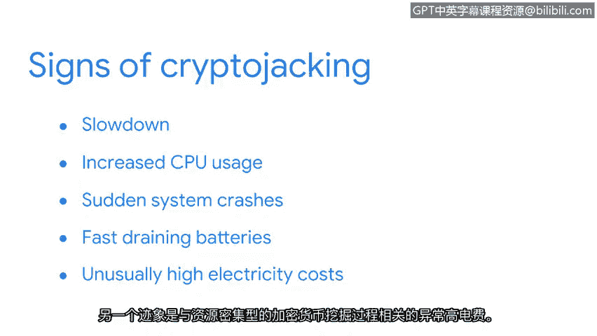

# 谷歌网络安全专业证书第五课：《资产、威胁和漏洞》（中英字幕，前面分p中字，后面分p英字） - P37：36_加密货币挖矿的崛起.zh - GPT中英字幕课程资源 - BV1QM4y1H7sh

Mowware has been around nearly as long as computers in its earliest forms。

 it was used by troublemakers as a form of digital vandalism。In today's digital world。

 Maware has become a profitable crime that attackers Jews for their own financial gain。

As a security professional， it's important that you remain aware of the latest evolutions。

 Let's take a closer look at one way Maware has evolved。

We'll then use this example to consider how malware can be spotted and how you can proactively protect against malware。

 Rasomware is one of the types of malware attackers used to steal money。

Another and more recent type of malware is cryptojacking。

Cryptojacking is a form of malware that installs software to illegally mine cryptocurrencies。

 You may be familiar with cryptocurrency from the news。 if you're new to the topic。

 cryptocurrencies are a form of digital money that have real world value。

 like physical forms of currency。 There are many different types。For the most part。

 they referred to as coins or tokens。In simple terms。

 crypto mining is a process used to obtain new coins。

 Crypto mining is similar to the process for mining for other resources like gold。

 mininging for something like gold involves machinery。

 such as trucks and bulldozers that can dig through the earth。 cryrypto coins， on the other hand。

 use computers instead。Rather than digging through the earth。

 the computers run software that dig through billions of lines of encrypted code。

When enough code is processed， a crypto coin can be found。Generally。

 more computers mining for coins mean more cryptocurrency can be discovered。

Criminals unfortunately figured this out beginning in 2017。

 crypto Jack and Malware started being used to gain unauthorized control of personal computers to mine cryptocurrency。

Since that time， cryptojacking techniques have become more sophisticated。

 Criminals now regularly target vulnerable servers to spread their mining software。

 devices that communicate with the infected server become infected themselves。

 The malicious code then runs in the background。 Mining for coins unknown to anyone。

 cryryptojackkin software is hard to detect。Luckily。

 security professionals have sophisticated tools that can help an intrusion detection system or I S is an application that monitors system activity and alerts some possible intrusions。

 When abnormal activity is detected like malware， mining for coins。

 The I D S alerts security personnel。 Despite their usefulness。

 detection systems have a major drawback。 New forms of malware can remain undetected。😊，Fortunately。

 there are subtle signs that indicate a device is infected where cryptoja and software or other forms of malware。

😊，By far， the most telling sign of a crypto jacket infection is slowdown。

Other signs include increased CPU usage， sudden system crashes and fast draining batteries。

 Another sign is unusually high electricity costs related to the resource intensive process of crypto mining。

It's also good to know that there are certain measures you can take to reduce the likelihood of experiencing a malware attack like cryptojacking。

These defenses include things like using browser extensions designed to block malware。

 using ad blockers， disabling JavaScript， and staying alert on the latest trends。😡。

Security analysts can also educate others in their organizations on malware attacks。

 while Krktojakin is still relatively new。 At are becoming more common。

 The type of malicious code cyber criminalrimin spread is continually evolving。

 It takes many years of experience to analyze new forms of malware。Nevertheless。

 you're well on your way towards helping defend against these threats。

