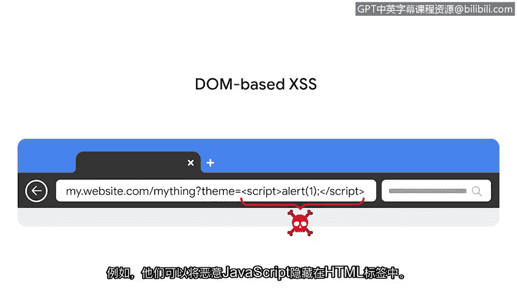

# 谷歌网络安全专业证书第五课：《资产、威胁和漏洞》（中英字幕，前面分p中字，后面分p英字） - P39：38_跨站脚本.zh - GPT中英字幕课程资源 - BV1QM4y1H7sh

Previously， we explored a few types of malware。Whether it is installed on an individual computer or a network server。

 all malicious software needs to be delivered to the target before it can work。

 Fishing and other social engineering techniques are common ways for malware to be delivered。

Another way it spread is using a broad class of threats known as web based exploits。

Web based exploits are malicious code or behavior thats used to take advantage of coding flaws in a web application。

Cyber criminalriminals target web based exploits to obtain sensitive personal information Aack occur because web applications interact when multiple users cross multiple networks。

 malicious hackers commonly exploit this high level of interaction using injection attacks。

An injection attack is malicious code inserted into a vulnerable application。

The infected application often appears to work normally。

 That's because the injected code runs in the background， unknown to the user。

 App are vulnerable to injection attacks because they are programmed to receive data inputs。

This could be something the user types， clicks， or something one program is sharing with another。

When coded correctly， applications should be able to interpret and handle user inputs。For example。

 lesson application is expecting the user to enter a phone number。

This application should validate the input from the user to make sure the data is all numbers and not more than 10 digits。

If the input from the user doesn't meet these requirements。

 the application should know how to handle it。😡，Web apps interact with multiple users。

 across many platforms。They also have a lot of interactive objects， like images and buttons。

This makes it challenging for developers to think of all the ways they should sanitize their input。

A common and dangerous type of injection attack that's a threat to web apps is cross site scripting。

Cross site scripting or XSS is an injection attack that inserts code into a vulnerable website or web application。

These attacks are often delivered by exploiting the two languages used by most websites。

 HTML and JavaScript。Both can give cyber criminalals access to everything that loads on the infected web page。

 This can include session cookies， geolocation， and even webcams and microphones。

There are three main types of cross site scripting attacks reflected， stored and do base。

A reflected X， SS attack is an instance where malicious script is sent to the server and activated during that server's response。

 A common example of this is the search bar of a website。😊，In a reflected XSS attack。

 criminals send their target a web link that appears to go to a trusted site。

When they click the link， it sends a HTTP request to the V site server。

The attacker's script is then returned or reflected back to the innocent user's browser here。

 The browser loads the malicious script because it trusts the services response。

 with the script loaded， information like section cookies are sent back to the attacker。

In a stored XSS attack， the malicious script isn't hidden in a link that needs to be sent to the server。

 Instead， a stored XSS attack is an instance where malicious script is injected directly on the server。

Here， attackers target elements of a site that are served to the user。

 This could be things like images and buttons that load when the site is visited。

 Infected elements activate the malicious code when a user simply visits the site。

Sttored XSS attacks can be damaging because the user has no way of knowing the site is infected beforehand。

 Finally， there's dome base XSS。D O M stands for document Ob model。

 which is basically the source code of a website。A domed based X。

 S S attack is an instance when malicious script exists in the web page of browser loads。

 unlike reflected X， S S， these attacks don't need to be sent to the server to activate。

In a dumb based attack， a malicious script can be seen in the URL。In this example。

 the website's URL contains parameter values。The parameter values reflect input from the user。Here。

 the site allows users to select color themes。When the user makes a selection。

 it appears as part of the URL。In a do base attack。

 criminals change the parameter that suspecting an input。For example。

 they could hide malicious JavaScript in the HTML tags。

 the browser would process the HTML and execute the JavaScript。

 hackers use these methods of cross site scripting to steal sensitive information。

Security analysts should be familiar with this group of injection attacks。 However。

 they're not the only ones， as we'll discover next time。

