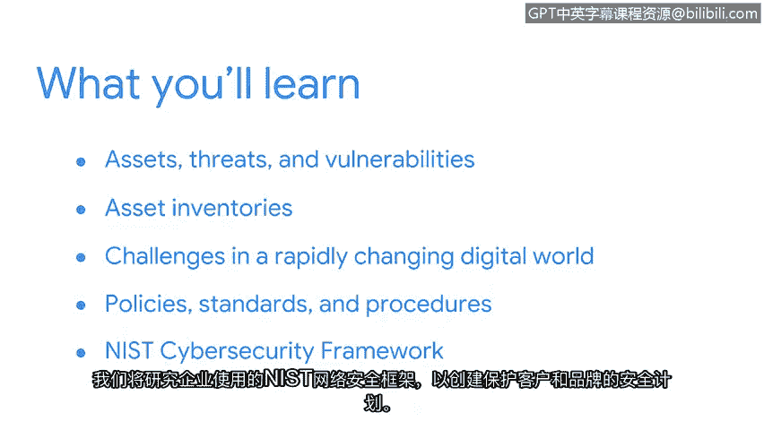

# 谷歌网络安全专业证书第五课：《资产、威胁和漏洞》（中英字幕，前面分p中字，后面分p英字） - P3：2_欢迎来到第一周.zh - GPT中英字幕课程资源 - BV1QM4y1H7sh

We all depend on technology so much nowadays。 Examples of this are all around us。

 Personal devices like smartphones help keep us in touch with friends and families across the globe。

 Whereabout technologies help us achieve personal goals and be more productive。

 Businesses have also come to embrace technology in everyday life from streamlining operations to automating processes。

 Our world is more connected because of technology。😊，The more we rely on technology。

 the more information we share。 As a result， an enormous amount of data is created every day。

 This huge surge in data creation presents unique challenges。😊。

As businesses become more reliant on technology， cyber criminals become more sophisticated in how they affect organizations。

Data breaches are becoming increasingly serious due to all the sensitive data businesses are storing。

One positive aspect of these challenges is a growing need for individuals like you。

 Security is a team effort。 Uni perspectives like yours are an asset to any organization。

 A team filled with diverse backgrounds， cultures and experiences is more likely to solve problems and be innovative as the breach at the breach hits the headlines is clear that organizations need more professionals focus on security。

😊，Companies around the globe are working hard to keep up with the demands of a rapidly changing digital landscape as the environment continues to transform。

 the more your personal experience is valuable。In this section， we'll start by exploring how assets。

 threats and vulnerabilities factor into security plans。 After that。

 we'll discuss the use of asset inventories in protecting the wide range of assets that companies have。

Then we'll consider the challenges in this rapidly changing digital world。 And finally。

 you'll gain an understanding of the building blocks of a security plan， its policies。

 standards and procedures。😊，We'll examine the NIS cybersecurity framework that companies use to create security plans that protects their customers and their brands。

I hope you're as excited to go on this journey into this world of security as I am。 Now。

 let's get started。😊。

