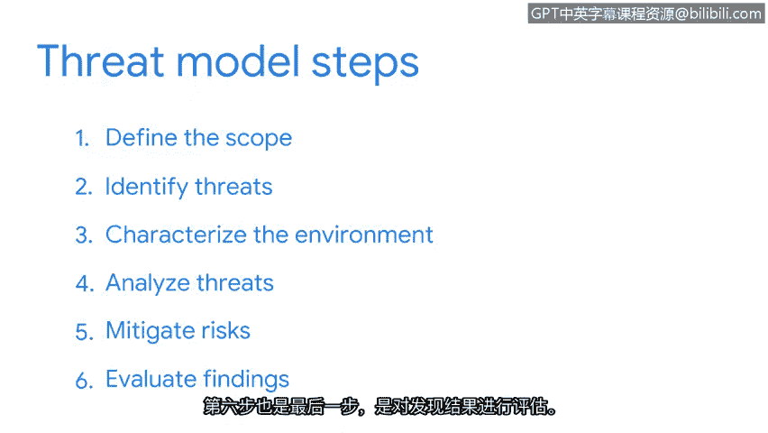

# 谷歌网络安全专业证书第五课：《资产、威胁和漏洞》（中英字幕，前面分p中字，后面分p英字） - P41：40_积极的安全方法.zh - GPT中英字幕课程资源 - BV1QM4y1H7sh

Preparing for attacks is an important job that the entire security team is responsible for。

Threat actors have many tools they can use depending on their target。 For example。

 attacking a small business can be different from attacking a public utility。

Each have different assets and specific defenses to keep them safe。In all cases。

 anticipating attacks is the key to preparing for them。In security。

 we do that by performing an activity known as threat modeling。

 threat modeling is a process of identifying assets their vulnerabilities and how each is exposed to threats。

 We apply threat modeling to everything we protect。Entire systems。

 applications or business processes all get examined from this security related perspective。

 C threat models is a lengthy and detailed activity。

They are normally performed by a collection of individuals with years of experience in the field。

Because of that， it's considered to be an advanced skill in security。However。

 that doesn't mean you won't be involved。There are several threat modeling frameworks used in the field。

Some are better suited for network security。 others are better for things like information security。

 or application development。In general， there are six steps of a threat model。

The first is to define the scope of the model。At this stage。

 the team determines what they're building by creating an inventory of assets and classifying them。

The second step is to identify threats。Here， the team defines all potential threat actors。

A threat actor is any person or group who presents a security risk。

Threat actors are characterized as being internal or external。For example。

 an internal threat actor could be an employee who intentionally exposed an asset to harm。

An example of an external threat actor could be a malicious hacker or a compete in business after threat actors have been identified。

 The team puts together what's known as an attack tree。

And a tax tree is a diagram that maps threats to assets。

The team tries to be as detailed as possible when constructing this diagram before moving on。

 Step 3 of the threat modelling process is to characterize the environment Here。

 The team applies and attacker mindset to the business。

 They consider how the customers and employees interact with the environment。

 Other factors they consider are external partners and third party vendors At step 4。

 their objective is to analyze threats Here， the team works together to examine existing protections in identify gaps。

They then rank threats according to their risk score that they assign。During step5。

 the team decides how to mitigate risks。At this point。

 the group creates their plan for defending against threats。The choices here are to avoid risk。

 transfer it， reduce it or accept it。 The sixth and final step is to evaluate findings。

 At this stage， everything that was done during the exercise is documented， fixes our apply。

 and the team makes note of any successes they had。

They also record any lessons learned so they can inform how they approach future threat models。

 That's an overview of the general threat modeling process。

What we explore was just one of many methods that exist。

