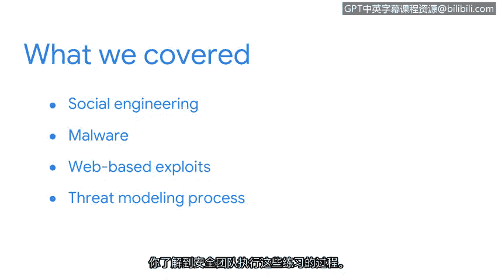

# 谷歌网络安全专业证书第五课：《资产、威胁和漏洞》（中英字幕，前面分p中字，后面分p英字） - P44：43_总结.zh - GPT中英字幕课程资源 - BV1QM4y1H7sh

Managing threats is a major part of what security professionals do。In this part of the course。

 we've explored some common types of cyber threats that you will likely encounter in the field。

Let's review。We started off discussing social engineering。

You learned that attackers have a variety of ways to trick their targets into sharing private information。

Social engineering techniques rely on exploiting people's trust and willingness to help Fishing attacks are one of the most common ways that attackers go about manipulating their targets。

Next， with Lordd malware。Here we discuss the major classes of malware， like viruses。

 Trojans and worms。You learned how to spot signs of infection。

 You also learned how Maoware has evolved and become more sophisticated over the years。After that。

 we turned our attention to web based exploits， specifically injection attacks。

 You learned about cross site scripting and SQL injection Two of the most common types of attacks facing organizations online。

 We discuss how each of these attacks are carried out。

 You also learned about how web applications can be protected from malicious code。😊，Finally。

 we explored the threat modeling process。You learn the process that security teams use to perform these exercises。

Unfortunately， cyber attacks and security breaches are a reality that we're challenged with on a regular basis。

However， being aware of the type of threats that exist and the threat modeling process provides an important foundation for your work as a security analyst。

