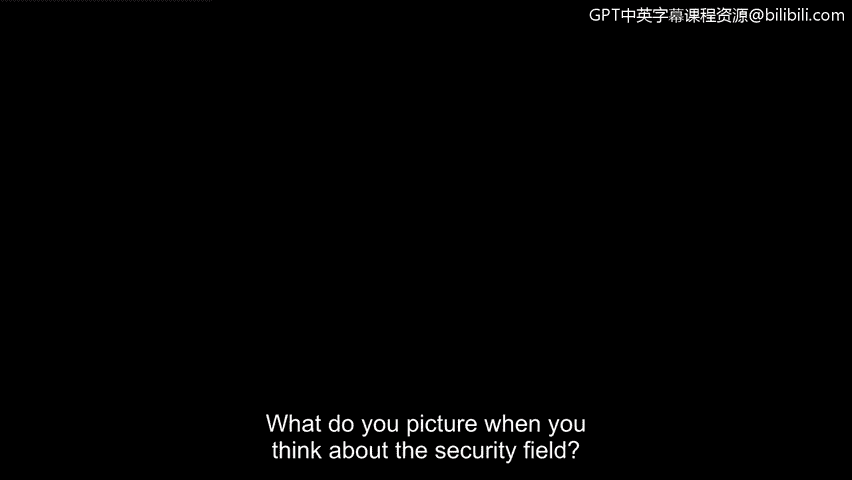
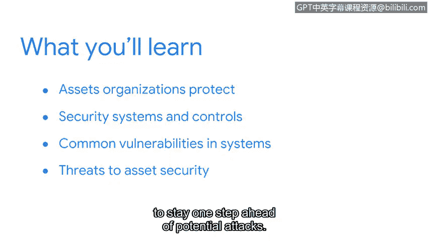

# 谷歌网络安全专业证书第五课：《资产、威胁和漏洞》（中英字幕，前面分p中字，后面分p英字） - P46：0_01_introduction-to-course-5.en_subtitled - GPT中英字幕课程资源 - BV1QM4y1H7sh

What do you picture when you think about the security fill。

 This might make you think of a dark room with people hunched over their computers。

 Maybe you picture a person in a lab carefully analyzing evidence。

 or maybe you imagine a guard standing watch in front of a building。The truth is。

 no matter what thoughts cross your mind， all of these examples are part of the wide world of security。

Hi， my name is Dequietia。I have worked as a security engineer for four years。

 I'm excited to be your instructor for this course and share some of my experience with you at Google。

 I'm part of a diverse team of security professionals who all have different backgrounds and unique perspectives。

 For example， in my role， I worked to secure Gmail。

 Part of my daily activities include developing new security features and fix and vulnerabilities in the application to make emails safer for our users。

 Some members on my team begin working in security after graduating for college。

 Many others found their way into the field after years of working in another industry。

 Security teams come in all different shapes and sizes。 Each member of a team has a role to play。

 While our specific functions within the group differ。 We all share the same objective。

 Pro valuable assets from harm。😊，Accomplishing this mission involves a combination of people。

 processes and tools。 In this course， you'll learn about each of these in detail。😊，First。

 you will be introduced to the world of asset security。

 You' will learn about the variety of assets that organizations protect and how these factor into a company's overall approach to security。

Then you'll begin exploring the security systems and controls that teams use to proactively protect people and their information。

All systems have weaknesses that can be approved upon。When those weaknesses are neglected or ignored。

 they can lead to serious problems。 In this section of the course。

 you'll focus on common vulnerabilities and systems and the way security teams stay ahead of potential problems。

Finally， you'll learn about the threats to asset security。

 You'll also be introduced to the threat modeling process that security teams use to stay one step ahead of potential attacks。

😊。

In this field， we try to do everything possible to avoid being put in a compromised position。

 By the end of this course， youll have a clearer picture of the ways people。

 processes and technology work together to protect all that's important。 throughout the course。

 you'll also get an idea of the exciting and career opportunities available to you。😊。

Security truly is an interdisciplinary field。 Your background and perspective is an asset。

Whether you're a recent college graduate or starting a new career path。

 the security field presents a wide range of possibilities。 So what do you say。

 Are you ready to go on this journey with me。😊。