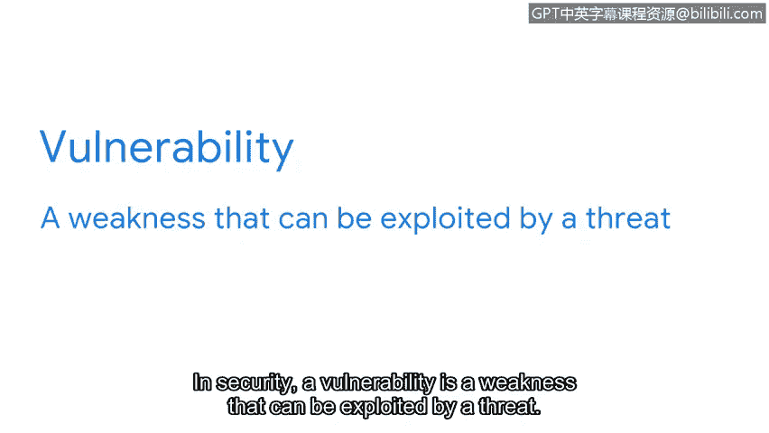

# 谷歌网络安全专业证书第五课：《资产、威胁和漏洞》（中英字幕，前面分p中字，后面分p英字） - P49：3_02_the-what-why-and-how-of-asset-security.en_subtitled - GPT中英字幕课程资源 - BV1QM4y1H7sh

Painting a portrait， perfecting a new basketball move， playing a solo on guitar。

 They all share something in common。 Can you guess what it is。😊，If you thought practice。

 you're absolutely correct。 It takes time， dedication and focus to improve these skills。

 The security profession is no different。 Planning for the future is a core skill that you'll need to practice all the time in security。

 we all deal with uncertainty by trying to solve problems before they arise。 For example。

 if you're going on a trip， you might think about the length of the trip and how much to pack。😊。

Maybe you're traveling somewhere cold。 You might bring coats and sweaters to help keep you warm。

We all want to fill the security of knowing that there's a plan if something goes wrong。

 Businesses are no different， Just like you， organizations try their best to plan ahead by analyzing risks。

 Security teams help companies by focusing on risk。

 insecurity a risk is anything that can impact the confidentiality。

 integrity or availability of an asset。 Our primary focus as security practitioners is to maintain confidentiality integrity and availability。

 which are the three components of the CIA triad。 The process of security risk planning is the first step towards protecting these cornerstones。

Each organization has their own unique security plan based on the risks they face。 Thankly。

 you don't need to be familiar with every possible security plan to be a good security practitioner。

 All you really need to know are the basis of how these plans are put together。😊。

Security plans are based on the analysis of three elements。 As， threats and vulnerabilities。

 Organizations measure security risks by analyzing how each can have an effect on confidentiality。

 integrity and availability of their information and systems。 Basically。

 they each represent the what， why and how of security。

 Let's spend a little time exploringing each of these in more detail。 As you might imagine。

 an asset is an item perceived as having value to an organization。

 This often includes a wide range of things。 Build， equipment。

 data and people are all examples of assets that businesses want to protect。

Let's examine this idea more by analyzing the assets of a home In a home。

 there is a wide range of assets， like people and personal belongings。

 The outside structure of a home is made of assets， too， like the walls， roof， windows and doors。

 All of these assets have value， but they differ in how they might be protected。

 Someone might place a lower priority on protecting the outside walls than on the front door。

 For example， This is because a burglar is more likely to enter through the front door than a wall。

 That's why we have locks。 with so many types of assets to think of。

 security plans need to prioritize resources。 After all， no matter how large a security team is。

 it would be impossible to monitor every single asset at all hours of the day。

Security teams can prioritize their efforts， based on threats。In security。

 a threat is any circumstance or event that can negatively impact assets。Much like assets。

 threats include a wide range of things。Going back to the example of a home。

 a threat can be a burglar who's trying to gain access。

burglars aren't the only type of threats that affect the security of windows and doors。

 What if either broke by accident， Strong winds can blow the door open during a bad storm or kids playing with a ball nearby can accidentally damage a window。

 If any of these thoughts cross your mind。 Great job。

 You're already demonstrating a security mindset。The final element of a security plan that we're going to cover are vulnerabilities。

 insecurity， a vulnerability is a weakness that can be exploited by a threat。

 A wheat lock on a front door。 for example， is a vulnerability that can be exploited by a burglar and old crack wood is a different vulnerability on that same front door that can increase the chances of storm damage。

 In other words， think of vulnerabilities as flaws within an asset。

 Asets can have many different types of vulnerabilities that are an easy target for attackers。

 We'll explore different types of threats and vulnerabilities in greater detail later。 For now。

 just understand that security teams need to account for a wide range of assets。

 threats and vulnerabilities to effectively plan for the future。😊。

