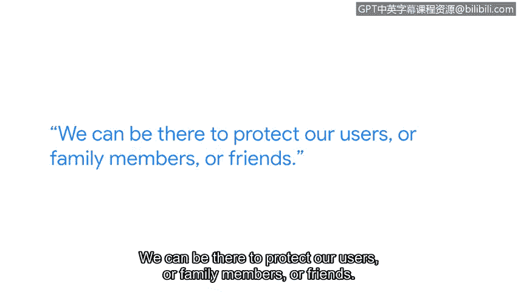

# 谷歌网络安全专业证书第五课：《资产、威胁和漏洞》（中英字幕，前面分p中字，后面分p英字） - P50：4_04_tri-life-in-asset-security.en_subtitled - GPT中英字幕课程资源 - BV1QM4y1H7sh

I'm Tree， a security engineer at Google。My department is detection and response。 Let's see。

 what does my every look like。 Well， of course， I have the free lunch and coffee， which is nice。

And then I finally get to my desk， and I open up the Sim to see what kind of exciting events are there for me to look into and what threats there could be out there for me to analyze。

 Also， I work on improving our analysis for detection of potential threats。

 So my security passion developed at a young age。 I was a victim of a hack， believe it or not。😊。

After school every day at that time， I would go home and play a computer game。 One day， I got home。

 I brought it up， and it said your C D key is in use by。

 And then it gave some strange name there that I didn't recognize。 At first， I felt shocked。

 I had bought this game myself。 and somebody stole my C D key。

 But it did provide me this motivation to start to learn how to defend myself。😊，For example。

 I learned about manual removal of malware， and that became one of my favorite topics。 Also for fun。

 I started doing some white hacker activity against some of my friends。😊。

Asset security is a very important field， and there's many varieties of assets that you could be looking into to protect。

 My favorite part is building the detections that actually have the potential to catch malicious behavior。

😊，In asset management security， you have the ability to accurately inventory all of the assets。

 which include IP user data， employee machines。 And to make sure you have a security posture that's on par with what you need。

 There's always new technology coming on the scene， new hardware。

 And we are responsible for understanding what potential new threats are out there。

Problem solving ability and creative thinking is important in cybersecurity because there's always complex problems。

 and people need to be able to think outside of the box。

 think creatively and think holistically as they approach their solutions to mitigate risks。

Cybersecurity is a noble occupation， many things can happen。

 many bad things can happen on the internet。But we can be there to stand up against it。

And we can be there to do something about it。 We can be there to protect our users or family members。

 or friends。

That responsibility is heavy， but also， of course， it's a very important mission。

 and I am proud to be within the security team。