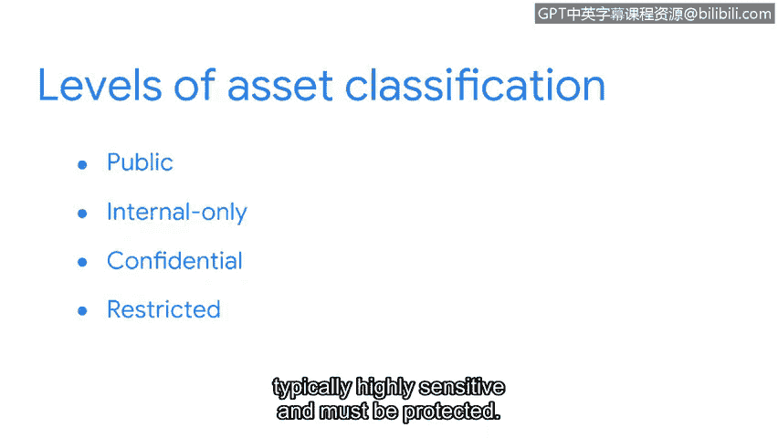

# 谷歌网络安全专业证书第五课：《资产、威胁和漏洞》（中英字幕，前面分p中字，后面分p英字） - P51：5_05_security-starts-with-asset-classification.en_subtitled - GPT中英字幕课程资源 - BV1QM4y1H7sh

It can be really stressful。When you have trouble finding something important。

You're late to an appointment and can't find your keys。

 We all find ourselves in situations like these at one time or another。Believe it or not。

 organizations deal with the same kind of trouble。Take a few seconds to think of the number of important assets you have nearby。

I'm thinking of my phone， wallet and keys， for example。Next。

 imagine that you're just joined a security team for a small online retailer。

 The company has been growing over the past few years， adding more and more customers。 As a result。

 they're expanding their security department to protect the increasing numbers of assets they have。

 Let's say each of you are responsible for 10 assets。 That's a lot of assets。

 Even in the small business setting。 That's an incredible amount of things that needs protecting A fundamental truth of security is you can only protect the things you account for。

 asset management is the process of tracking assets and the risk that affects them。😊。

All security plans revolve around asset management。

 recall that assets include any item perceived as having value to our organization。 Equipment。

 data and intellectual property are just a few of the wide range of assets businesses want to protect。

 A critical part of every organization security plan is keeping track of its assets。

Asset management starts with having an asset inventory。

 a catalog of assets that need to be protected。This is an essential part of protecting organizational assets。

 Without this record， organizations runs the risk of losing track of all that's important to them。

 A good way to think of asset inventories is as a shepherd， protecting sheep。

Having an accurate count of the number of sheep help in a lot of ways。 For example。

 it would be easier to allocate resources like food to take care of them。

Another benefit of asset inventory might be that you get an alert if one of them goes missing。

Once more， think of the important assets you have nearby。 Just like me。

 you're probably able to rate them according to the level of importance。

I would rank my wallet ahead of my shoes， for example， in security。

 this practice is known as asset classification。 In general。

 asset classification is the practice of labeling assets based on the sensitivity and importance to an organization。

Organizations label assets differently。 Many of them follow a basic classification scheme。Public。

 internal only， confidential and restricted。Public assets can be shared with anyone internal only can be shared with anyone in the organization。

 but should not be shared outside of it。And confidential assets should only be assessed by those working on a specific project。

 Asets classified as restricted are typically highly sensitive and must be protected。

Assets with this label are considered need to know。

 Examples include intellectual property and health or payment information。 For example。

 a growing online retailer might mark internal emails about a new product as confidential because those working on the new product should know about it。

 They might also label the doors at their offices with a restricted sign to keep everyone out who doesn't have a specific reason to be in there。

These are just a couple of everyday examples that you may be familiar with from your prior experience。

 For the most part， classification determines whether an asset can be disclosed。

 altered or destroyed。 assetset management is a continuous process。

 one that helps uncover unexpected gaps in security for potential risks。

Keeping track of all that's important to our organization is an essential part of security planning。

