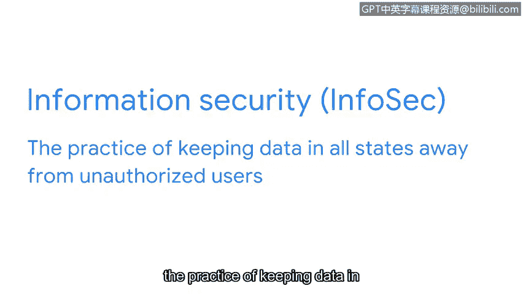

# 谷歌网络安全专业证书第五课：《资产、威胁和漏洞》（中英字幕，前面分p中字，后面分p英字） - P52：6_01_assets-in-a-digital-world.en_subtitled - GPT中英字幕课程资源 - BV1QM4y1H7sh

Welcome back。We've covered a lot of information so far。

 I hope you're having as much fun exploring the world of security as I am。😊。

We have to explore what organization assets are and why they need protection。😡。

You've also gotten a sense of the tremendous amount of asset security teams protect。Previously。

 we began examining security asset management and the importance of keeping track of everything that's important to an organization。

😊，Security teams classify assets based on value。 Next。

 let's expand our security mindset and think about this question。

What exactly is valuable about an asset？These days， the answer is often information。

Most information is in a digital form。 We call this data。Data is information that is translated。

 processed or stored by a computer。We live in a connected world。

 Billillions of devices around the world are linked to the Internet and are exchanging data with each other all the time。

 In fact， millions of pieces of data are being passed to your device right now。

 When compared to physical assets。 digital assets have additional challenges。

 What you will need to understand is that protecting data depends on where that data is and what it' doing。

 Security teams protect data in three different states。 and use and transit and at rest。

 Let's investigate this idea in greater detail。 Data in use is data being accessed by one or more users。

 Imagine being at a part with your laptop。 It's a nice。

 sunny day and you stop at a bench to check your email。 This is an example of data in use。

 As soon as you log in， your inbox is considered to be in use。 Next is data and transit。

 Data in transit is data traveling from one point to another。😊，While you're signed into your account。

 a message from one of your friends appear。 They sent you an interesting article about the growing security industry。

 You decide to reply， thanking them for sending this to you。 When you click send。

 this is now an example of data and transit。😊，Finally， there's data at rest。

 Data at rest is data not currently being accessed。In this state。

 data is typically stored on a physical device。 An example of data at rest would be when you finish checking your email and close your laptop。

 you then decide to pack up and go to a nearby cafe for breakfast。

 As you make your way from the park towards the cafe。 The data in your laptop is at rest。

 So now that we understand these states of data。 Let's connect this back to asset management。 Earl。

 I mentioned that information is one of the most valuable assets that companies can have。😊。

Information security or infosec is the practice of keeping data in all states away from unauthorized users。

 weakak information security is a serious problem。 It can lead to things like identity theft。

 financial loss and reputational damage。

These events have potential to harm organizations， their partners and their customers。

And there is more to consider in your work as a security analyst。

 as our digital world continually changes。 we are adapting our understanding of data at rest。

 Phy devices like our smartphones more commonly store data in the cloud。

 meaning that our information isn't necessarily at rest just because our phone is resting on a table。

😊，We should always be mindful of new vulnerabilities as our world becomes increasingly connected。

Remember， protecting data depends on where the data is and what it's doing。

 keeping track of information is part of the puzzle that companies solve when considering their security plan。

 understanding the three states of data enable security teams to analyze risks and determine an asset management plan for different situations。

