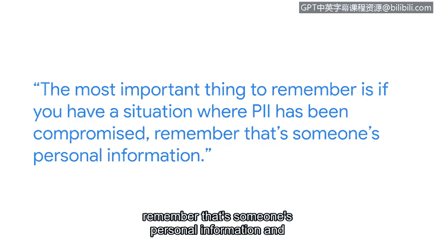

# 谷歌网络安全专业证书第五课：《资产、威胁和漏洞》（中英字幕，前面分p中字，后面分p英字） - P59：13_06_heather-the-importance-of-protecting-pii.en_subtitled - GPT中英字幕课程资源 - BV1QM4y1H7sh

。

Hello， my name is Heather and I'm the Vice President of security Engineering at Google。

P I I is everywhere。 It's a fundamental part of how we are all working online all the time。

 If you are using online read sources， you are probably putting your P I I out there somewhere。

 There are some of your P I I that lots of people know， such as your name。

And then there's sensitive data that you don't want very many people to know。

 such as your bank account number or your private medical health information。

 And so we make these distinctions。Often because this kind of information needs to be handled differently。

 everything that we do now from school to voting to registering our car happens online and because of that。

 it's so important that we have safety built in by default into all of our systems。

 here are some tips。You should always encrypt the data as much as you can when it's being stored at rest。

 And secondly， when it's transiting over the internet。

 we always want to encrypt it using T L S or SSL。 Third， within your company。

 you should think very clearly about who has access to that data。It should be almost no one。

 if it's very sensitive。And in the rare cases where somebody does need to access that data。

There should be a record of that access。Who accessed it and a justification as to why。

 And you should have a program to look at the audit records for that data。

 The most important thing to remember is if you have a situation where P I I has been compromised。

Remember thats someone's personal information。 and your response wants to be grounded in that reality。

 They need to be able to trust the infrastructure， the systems， the websites， the devices。

 they need to be able to trust the experience they're having。 And for me， that's the mission。

 to help keep billions of people safe online every day。

