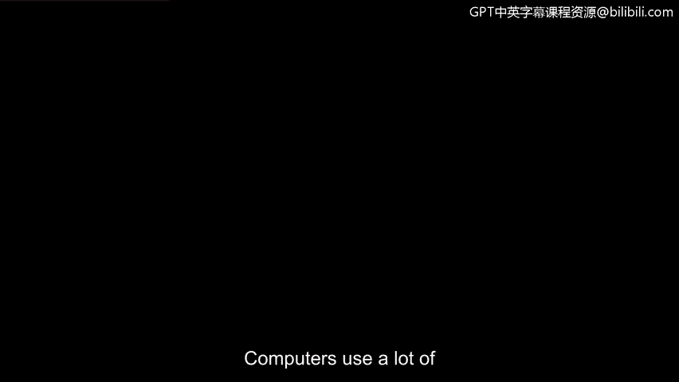
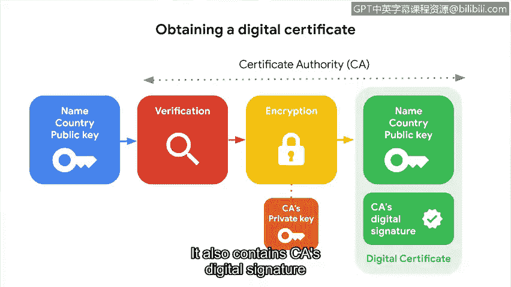

# 谷歌网络安全专业证书第五课：《资产、威胁和漏洞》（中英字幕，前面分p中字，后面分p英字） - P61：15_02_public-key-infrastructure.en_subtitled - GPT中英字幕课程资源 - BV1QM4y1H7sh

Computers use a lot of encryption algorithms to send and store information online。

 They're all helpful when it comes to hiding private information。

 but only as long as their keys are protected。Can you imagine having to keep track of the encryption keys。

 protecting all of your personal information online？Neither can I。

And we don't have to thanks to something known as public key infrastructure。

Public key infrastructure， or PKI is an encryption framework that secures its exchange of information online。

 Its a broad system that makes access and information fast， easy and secure。So how does it all work？

😊，PKI is a two step process。 It all starts with this change of encrypted information。

This involves either asymmetric encryption， symmetric encryption， or both。

Asymmetric encryption involves the use of a public and private key pair for encryption and decryption of data。

 Let's imagine this as a box that can be opened with two keys。 One key。

 the public key can only be used to access the slot and add items to the box。

Since the public key cant be used to remove items， it can be copied and shared with people all around the world to add items。

 On the other hand， the second key， the private key opens the box fully so that the items inside can be removed。

 Only the owner of the box have access to the private key that unlocks it。

 usingsing a public key allows the people and servers your communicating with to see and send you encrypted information that only you can decry with your private key。

 This two key system makes asymmetric encryption a secure way to exchange information online。

 However， it also slows down the process。 symmetric encryption On the other hand is a faster and simpler approach to key management。

 symmetric encryption involves the use of a single secret key to exchange information。😊。

Let's imagine the log box again。 instead of two keys， symmetric encryption uses the same key。

The owner can use it to open the box， add items， and close it again。When they want to share access。

 they can give the secret key to anyone else to do the same。

 Exchanging a single secret key may make web communications faster， but it also makes it less secure。

PK I uses both asymmetric and symmetric encryption， sometimes in conjunction with one another。

 It all depends on whether speed or security is the priority。 For example。

 mobilele check applications use asymmetric encryption to establish a connection between people at the start of a conversation when security is the priority。

At theward， when the speed of communications back and forth is the priority。

 symmetric encryption takes over。 while both have their own strengths and weaknesses。

 they share a common vulnerability， establishlishing trust between the sender and receiver。😊。

Both processes rely on sharing keys that can be misused， lost or stolen。

This isn't a problem when we exchange information in person because we can use our senses to tell the difference between those we trust and those we don't trust。

 Comps， on the other hand， aren't naturally equipped to make this distinction。

 That's where the second step of P K I applies。 P K I addresses the vulnerability of key sharing by establishing trust using a system of digital certificates between computers and networks。

A digital certificate is a file that verifies the identity of a public keyholder。

Most online information is that using digital certificates， Use， companies and networks hold one。

 and it changes them when communicating information online as a way of signaling trust。

Let's look at an example of how digital certificates are created。

 Let's say an online business is about to launch their website。

 and they want to obtain a digital certificate。When they register their domain。

 the hosting company sends certain information over to a trusted certificate authority or CA A。

 the information provided is usually basic things like the company name and the country where its headquarters are located。

A public key for the site is also provided。The certificate authority then uses this data to verify the company's identity When it's confirmed。

 the C A encrypts the data with its own private key。 Finally。

 they create a digital certificate that contains the encrypted company data。 It also contains C。

 A digital signature to prove that it's authentic。😊。

Digital certificates are a lot like a digital ID badge that's used online to restrict or grant access to information。

 This is how PKI solves the trust issue。Combined with asymmetric and symmetric encryption。

 this two step approach to exchanging secure information between trusted sources is what makes PKI such a useful security control。

