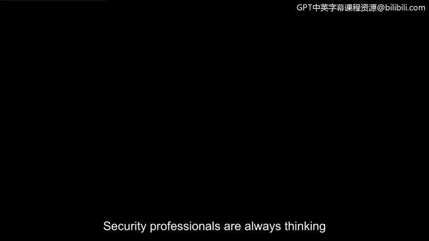
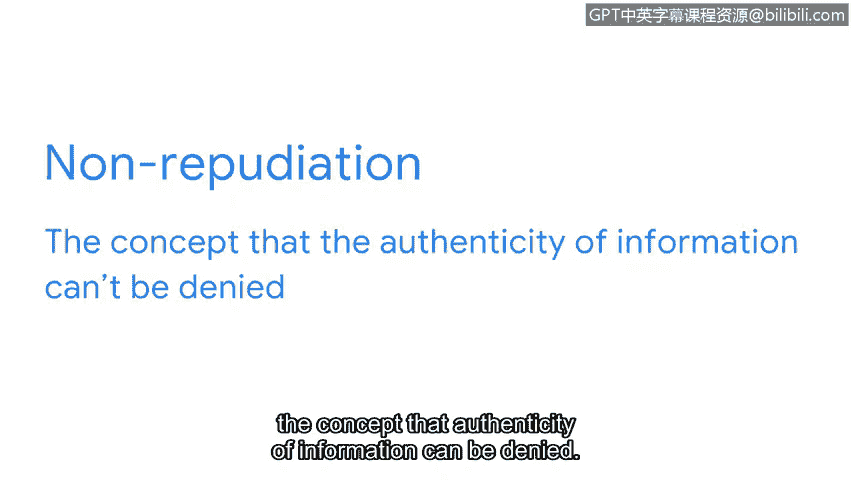
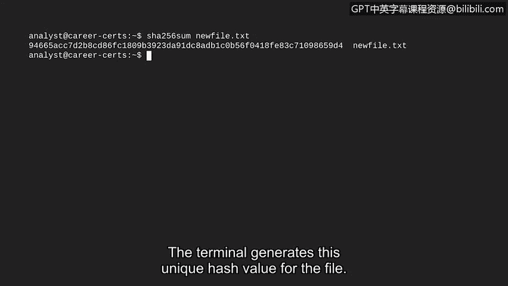

# 谷歌网络安全专业证书第五课：《资产、威胁和漏洞》（中英字幕，前面分p中字，后面分p英字） - P62：16_05_non-repudiation-and-hashing.en_subtitled - GPT中英字幕课程资源 - BV1QM4y1H7sh

Security professionals are always thinking about vulnerabilities is how we stay ahead of threats。

We spent some time together exploring a couple forms of encryption。

The two types we've discussed produce keys that are shared when communicating information。

Encryption keys are vulnerable to being lost or stolen。

 which can lead to sensitive information at risk。 Let's explore another security control that helps companies address this weakness。

 A hash function is an algorithm that produces a code that can't be decrypted。

Unlike asymmetric and symmetric algorithms， hash functions are one way processes that do not generate decryption keys。

 Instead， these algorithms produce a unique identifier known as a hash value or digestig。

 Here's an example to demonstrate this。 Imagine a company has an internal application that is used by employees and is stored in a shared drive。

After passing through a hashing function， the program receives its hash value。For example purposes。

 we created this relatively short hash value with the M D5 hashing function。 General。

 standard hash functions that produce longer hashes are preferred for being more secure。😊，Next。

 let's imagine an attacker replaces the program with a modified version that performs malicious actions。

😊，The malicious program may work like the original。 However。

 if so much as one line of code is different from the original。

 it will produce a different hash value。By comparing the hash values。

 we can validate that the programs are different。Attackers use tricks like this often。

 because they're easily overlooked。Fortunately， hash values help us identify when something like this is happening in securitycur。

 hashes are primarily used as a way to determine the integrity of files and applications。

 Data integrity relates to the accuracy and consistency of information。

 This is known as known repudiation。 The concept that authenticity of information can be denied。

 hash functions are important security controls that make proven data integrity possible。

 Analyts use them frequently。 One way to do this is by finding the hash value of files or applications and comparing them against known malicious files。

 For example， we can use the Linux command line to generate the hash value for any file on your computer。

 We just launch the shell and type the name of the hashian algorithm we want to use。 In this case。

 we're using a common one known as Shaw 256 Next， we need to enter the file name of any file we want to hash。

😊。

Let's hash the contents of new file dot T X， T。 Now， we'll press enter。

The terminal generates this unique hash value for the file。

These tools can be compared with the hash values of known online viruses。

 One such database is virus total。 This is a popular tool among security practitioners that's useful for analyzing suspicious files。

 Doomains， I Ps and URLs， As we've explored， even the slightest change in input results in a totally different hash value。

 hash functions are intentionally designed this way to assist with matters of non repudiation。😊。

They equip computers with a quick and easy way to compare input and output values and validate data integrity。

 Pretty cool， right。😊。