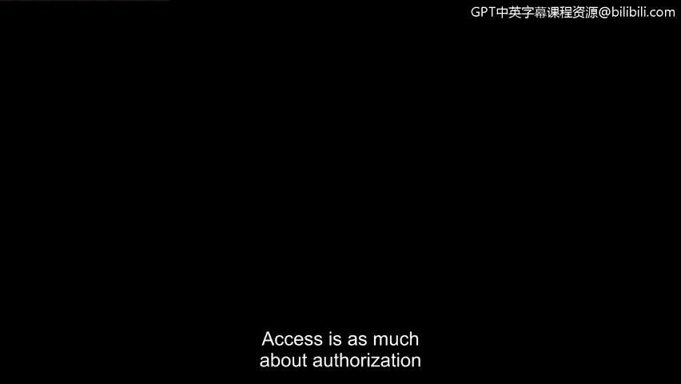
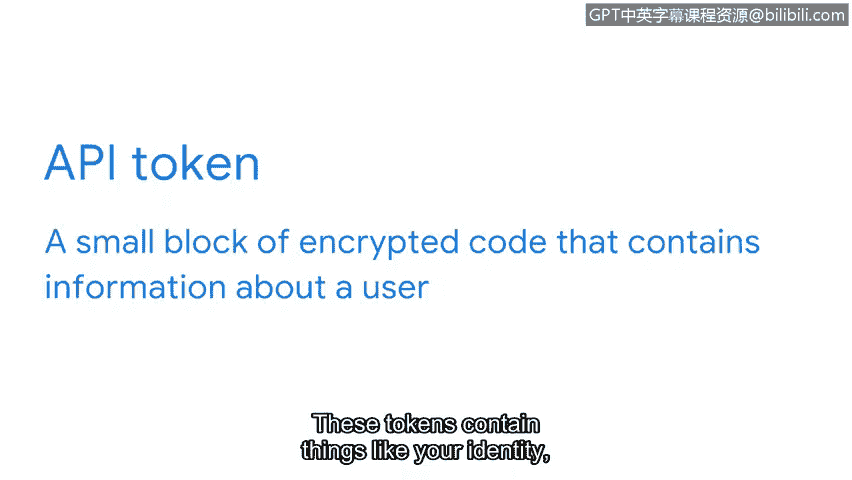

# 谷歌网络安全专业证书第五课：《资产、威胁和漏洞》（中英字幕，前面分p中字，后面分p英字） - P64：18_03_the-mechanisms-of-authorization.en_subtitled - GPT中英字幕课程资源 - BV1QM4y1H7sh

Access is as much about authorization as it is about authentication。

 One of the most important functions of access controls is how they assign responsibility for certain systems and processes。

Next up in our explorationiration of access control systems are the mechanisms of authorization。

 These protocols actually work closely together with authentication technologies While one validates who the user is。

 the other determines what they're allowed to do。Let's take a look at the next part of authentication。

 authorization， and accounting framework that protects private information。Earlier。

 we learned about the principle of lease privilege。

 Authorization is linked to the idea that access to information only lasts as long as needed。

 Authorization systems are also heavily influenced by this idea。

 In addition to another important security principle， The separation of duties。

 Se of duties is the principle that users should not be given levels of authorization that will allow them to misuse a system。

Separating duties reduces the risk of system failures and inappropriate behavior from users。

For example， a person responsible for providing customer service shouldn't also be authorized to rate their own performance in this position。

 they could easily neglect their duties while continuing to give themselves high marks with no oversight。

 Similarlyly， if one person was authorized to develop and test a security system。

 They are much more likely to be unaware of its weaknesses。

Both the principle of lease privilege and the concept of separating duties apply to more than just people。

 they apply to all systems， including networks， databases。

 processes and any other aspect of the organization。Ultimately。

 authorization depends on a system or user's role。 when it comes to securing data over network。

 there are a couple of frequently used access controls that you should be familiar with。

HtT basicsic Oth and OOth。Have you ever wondered what the H T TP and Web addresses stood for。

It stands for Hypertex transfer protocol， which is how communications are established over network。

 H TTP uses what is known as basic O。 The technology used to establish a user's request to access a server。

BasicOuth works by sending an identifier every time a user communicates with a web page。

 some websites still use basicOuth to tell whether or not someone is authorized to access information on that site。

However， the protocol is considered to be vulnerable to attacks text because it transmits username and password openly over the network。

Most websites today use HTTPS instead， which stands for Hypertex Transfer protocolcol Secu。

This protocol doesn't expose sensitive information like access credentials when communicating over the network。

Another secure authentication technology used today is OOth。

 OOth is an open standard authorization protocol that shares designated access between applications。

 For example， you can tell Google that it's okay for another website to access your profile to create an account instead of requesting and sending sensitive username and passwords over the network。

 OOth uses API tokens to verify access between you and its service provider。😊。

An API token is a small block of encrypted code that contains information about a user。

These tokens contain things like your identity， site permissions and more O off sends and receives access requests using API tokens by passing them from a server to a user's device。

😊。

Let's explore what's going on behind the scenes。 When you authorize a site to create an account using your Google profile。

 All of Google's usual login protocols are still active。

If you have multifactor authentication enabled on your account and you should。

 you'll still have the security benefits that it provides。 API tokens minimize risk in a major way。

 These API tokens serve as an additional layer of encryption that helps to keep your Google password safe in the event of a breach on another platform。

Basic Oth and OOG are just a couple examples of authorization tools that are designed with the principles of least privilege and separation of duty in mind。

There are many other controls that help limit the risk of unauthorized access to information。

In addition to controlling access， it's also important to monitor it。 In our next video。

 we'll focus on the third and final part of the authentication。

 authorization and accounting framework。