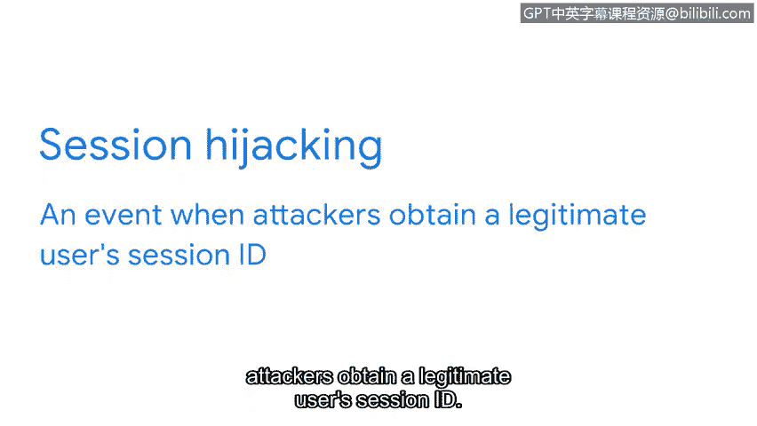

# 谷歌网络安全专业证书第五课：《资产、威胁和漏洞》（中英字幕，前面分p中字，后面分p英字） - P65：19_04_why-we-audit-user-activity.en_subtitled - GPT中英字幕课程资源 - BV1QM4y1H7sh

Have you ever wondered if your employer is keeping a record or when you log into company systems。

 Well， they are if they're implementing the third and final function of the authentication。

 authorization and accounting framework。Accounting is the practice of monitoring the access logs of a system。

These logs contain information like who access the system and when they access it and what resources they use。

 Security analysts use access logs a lot。 The data they contain is a helpful way to identify trends like failed login attempts they also used to uncover hackers who have gained access to a system and for detecting an incident like a data breach。

 In this fill， access logs are essential。Oftentimes。

 analyzing them is the first procedure you'll follow when investigating a security event。

 So how do access logs compile all this useful information。 Let's examine this more closely。😊。

Anytime a user accesses a system， they initiate was called a session。

A session is a sequence of network， HTTP， basic author requests and responses associated with the same user。

 like when you visit a website。Assess laws are essentially records of sessions that capture the moment a user enters a system until the moment they leave it。

 two actions are triggered when the session begins。The first is the creation of a session I D。

 A session I D is a unique token that identifies a user and their device while accessing the system。

 Session Is are attached to the user until they either close their browser or the session times out。

 The second action that takes place at the start of a session is in a change of session cookies between the server and a user's device。

 A session cookie is a token that websites use to validate a session and determine how long that session should last。

😊，When cookies are exchanged between your computer and a server。

 your session I D is read to determine what information the website should show you。

Cookies make web sessions safer and more efficient。

This exchange of tokens mean that no sensitive information， like username and passwords are shared。

Session cookies prevent attackers from obtaining sensitive data。 However。

 there is other damage that they can do with a stolen cookie。

 an attacker can impersonate a user using their session token。

 This kind of attack is known as session hijacking。

 Session hijacking is an event when attackers obtain a legitimate user session I D。

During these kinds of attacks， cyber criminals impersonate the user， causing all sorts of harm。

 Mo or private data can be stolen。 If， for example。

 hijacks obtained a single sinon credential from stolen cookies。

 they can even gain access to additional systems that otherwise seem secure。

This is one reason why accounting and monitoring session logs is so important。

 Un activity on access logs can be an indication that information has been improperly accessed or stolen。

 At the end of the day， accounting is how we gain valuable insight that makes information safer。😊。

