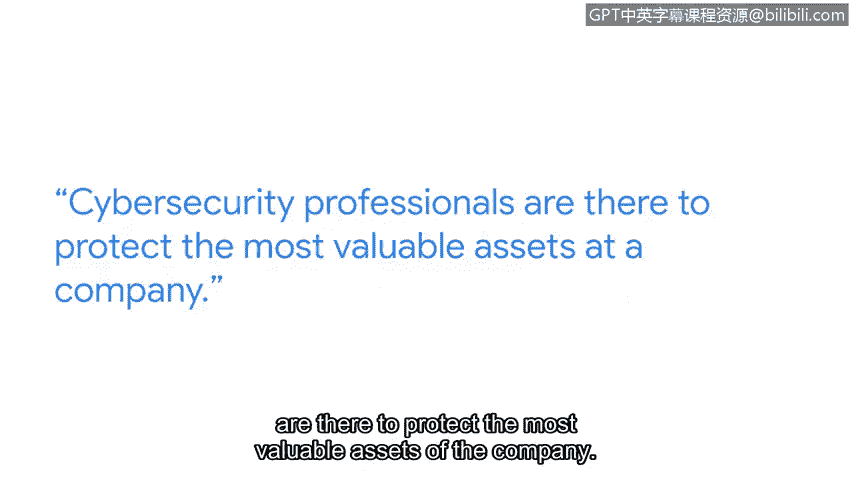

# 谷歌网络安全专业证书第五课：《资产、威胁和漏洞》（中英字幕，前面分p中字，后面分p英字） - P66：20_05_tim-finding-purpose-in-protecting-assets.en_subtitled - GPT中英字幕课程资源 - BV1QM4y1H7sh

。

My names Tim， and I work on the detection of response team at Google。

 You can think of us as the smoke detectors and the fire departments at Google。 So。

 you know what our job is， is to detect harmful activity that may affect Google and its users。

 The stakes here are very， very high。 So imagine what you have on Google， know， whether it's docs。

 Its pictures， your financial information。 of your， you know， some of your secrets。

 some things that you don't want anybody to know。 Those are the things that we're protecting cybersecurity professionals are there to protect the most valuable assets at a company。

 You'll be there to protect that。 And that direct line from what you're doing to what the company feels is most important and most valuable and protecting that I think provides a lot of purpose for folks and provides a lot of motivation and provides the basis and the foundation for a very very satisfying career。

 Cysecurity is a profoundly rewarding career。 It is a function。😊。

That is critical at many， many companies， and it is a career that is in high demand。

 and there is an absolute shortage of talented labor out there。 So from that aspect。

 if you're looking for a path to a viable， long term rewarding career。

 this is as straight a path to that， as you can imagine。

