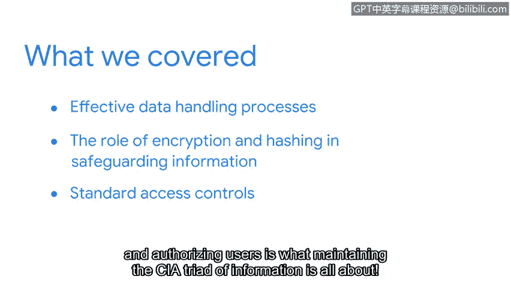

# 谷歌网络安全专业证书第五课：《资产、威胁和漏洞》（中英字幕，前面分p中字，后面分p英字） - P67：21_01_wrap-up.en_subtitled - GPT中英字幕课程资源 - BV1QM4y1H7sh

Our focus in this section was on a major theme of security， protecting assets。

 A large part of this relates to privacy。We should all enjoy the right to decide who can access our information。

 As we learn， there are several controls in place that help secure assets。😊。

We begin the section by exploring effective data handling processes that are found on the principle of least privilege。

 We then explored the role of encryption in hashing， and safeguarding information。

We explored how symmetric and asymmetric encryption works and how hashes furthers safeguard data from harm。

We then turned our attention to standard access controls。

 properly authenticating and authorizing users is what maintaining the CIA triad of information is all about。

 We use the AaA framework of security to take a detailed tour of identity and access management systems and the access controls that validate whether or not someone is who they claim to be。

Well done。 Ma it through the first half of the course。 You're making great progress so far。

 And I hope you keep it up。 Remember， your background and experiences are valuable in this fill。

 This， combined with the concepts we're coveringing。

 would make you a valuable contributor to any security team up until this point。

 we've been exploring the defensive side of security。

 But security isn't all about planning ahead and waiting for something to happen。

 And the next part of our journey， we're going to continue developing a security mindset by taking a more proactive look at security from the perspective of attackers。

 I'll meet you there。😊。

