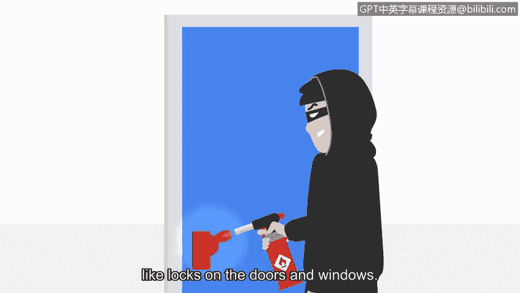

# 谷歌网络安全专业证书第五课：《资产、威胁和漏洞》（中英字幕，前面分p中字，后面分p英字） - P69：23_02_vulnerability-management.en_subtitled - GPT中英字幕课程资源 - BV1QM4y1H7sh

For every asset that needs protecting， there are dozens of vulnerabilities。

 Find those vulnerabilities and fixing them before they become a problem is the key to keep an asset safe。

 We've already covered what a vulnerability is。 Re that a vulnerability is a weakness that can be exploited by a threat。

That word can is an important part of this description。 Why is that。

Let's us board that together to find out more。Imagine I handed you an important document and asked you to keep it safe。

How would you do that， Some of you might first think about locking it up in a safe place。

Behind this is the understanding that because documents can be easily moved。

 they are vulnerable to theft。When other vulnerabilities come to mind。

 like how paper burns easily or doesn't resist water， you might add other protections。

Similar to this example， security teams plan to protect assets according to their vulnerabilities and how they can be exploited and security at exploitit is a way of taking advantage of a vulnerability。

 Besides finding vulnerabilities， security planning relies a lot on thinking of exploits。For example。

 there are burglars out there who want to cause harm。

Homes have vulnerable systems that can be exploited by a burglar。An example are the windows。

 Gla is vulnerable to being broken。 A burglar can exploit this vulnerability by using a rock to break the window。

Thinking of this vulnerability and exploit ahead of time allows us to plan ahead。

We can have an alarm system in place to scare the burglar away and alert the police。

Security teams spend a lot of time finding vulnerabilities and thinking of how they can be exploited。

 They do this with a process known as vulnerability management。

 Vulnerability management is the process of finding and patching vulnerabilities。

 Vulnerability management help keep assets safe。 It's a method of stopping threats before they can become a problem。

Vulnerability management is a four step process。 The first step is to identify vulnerabilities。

 The next step is to consider potential exploits of those vulnerabilities。

Third is to prepare defenses against threats。And finally。

 the fourth step is to evaluate those defenses。When the last step ends， the process starts again。

 Vulnerability management happens in a cycle。 It's a regular part of what security teams do because there are always new vulnerabilities to be concerned about。

This is exactly why a diverse set of perspectives is useful。

 Having a wide range of backgrounds and experiences only strengthened security teams and their ability to find exploits。

 However， even large and diverse security teams can't keep track of everything。

 New vulnerabilities are constantly being discovered。 These are known as zero day exploits。

 A zero day is an exploit that was previously unknown。

 The term0 day refers to the fact that the exploit is happening in real time with zero days to fix it。

😊，These kind of exploits are dangerous。 They represent threats that haven't been planned for yet。

 For example， we can anticipate the possibility of a burglar breaking into our home。

 We can plan for this type of threat by having defenses in place like locks on the doors and windows。

 A zero day exploit would be something totally unexpected。

 like the lock on the door falling off from intense heat。

0 day exploits are things that don't normally come to mind。 For example。

 this might be a new form of spyware infecting a popular website。 when zero day exploits happen。

 They can leave assets even more vulnerable to threats they already are vulnerability management is the process of finding vulnerabilities and fixing their exploits。

 That's why the process is performed regularly at most organizations。

 Perhaps the most important step of the process is identifying vulnerabilities。

 We'll explore this step in more details next time we get together。 I'll meet you again then。

