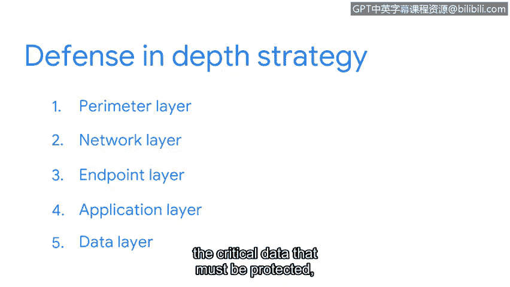

# 谷歌网络安全专业证书第五课：《资产、威胁和漏洞》（中英字幕，前面分p中字，后面分p英字） - P70：24_03_defense-in-depth-strategy.en_subtitled - GPT中英字幕课程资源 - BV1QM4y1H7sh

A layered defense is difficult to penetrate When one barrier fails。

 another takes its place to stop and attack。 Defense in depth is a security model that makes use of this concept。

It's a layered approach to vulnerability management that reduces risk。

Defense and depth is commonly referred to as the castle approach because it resembles the layered defenses of a castle。

In the Middle Ages， these structures were very difficult to penetrate。

 They featured different defenses， each unique in its design that posed different challenges for attackers。

 For example， a water filled barrier called a moat usually formed a circle around the castle。

 preventing threats like large groups of attackers from reaching the castle walls。

The few soldiers that made it pass the first layer of defense were then faced with a new challenge。

 giant stone walls。 A vulnerability of these structures were that they could be climbed。

 If attackers tried exploiting that weakness。 Guess what？

 They were met with another layer of defense。 Watch towers filled with defenders ready to shoot arrows and keep them from climbing。

 Each level of defense of these medieval structures minimize the risk of attacks by identifying vulnerabilities and implementing a security control should one system fail。

Defense and depth works in a similar way。The defense and debt concept can be used to protect any asset。

Its mainly used in cybersecurity to protect information using a five layer design。

Each layer features a number of security controls that protect information as it travels in and out of the model。

 The first layer of defense in depth is the peri layer。

This layer includes some technologies that we've already explored， like username and passwords。

Mainly， this is a user authentication layer that filters external access。

 It function is to only allow access to trusted partners to reach the next layer of defense。Second。

 the network layer is more closely aligned with authorization。

The network layer is made up of other technologies like network firewalls and others。

 Next is the endpoint layer。Inpoints refer to the devices that have access on a network。

 They could be devices like a laptop， desktop or a server。

 Some examples of technologies that protect these devices are antivirus software。After that。

 we get to the application layer。 This includes all the interfaces that are used to interact with technology。

😊，At this layer， security measures are programmed as part of an application。

One common example is multi factor authentication。You may be familiar with having to enter both your password and a code sent by S M S。

This is part of the application layer of defense。And finally。

 the fifth layer of defense is the data layer At this layer。

 we've arrived at the critical data that must be protected， like personally identifiable information。

 One security control that is important here， in this final layer of defense is assets classification。

 like I mentioned earlier， information passes in and out of each of these five layers。

 whenever it exchange over a network。😊。

There are many more security controls， aside from the few that I mentioned that are part of the defense and depth model。

A lot of businesses design their security systems using the defense and depth model。

 understandingstanding this framework hopefully gives you a better sense of how an organization's security controls work together to protect important assets。

