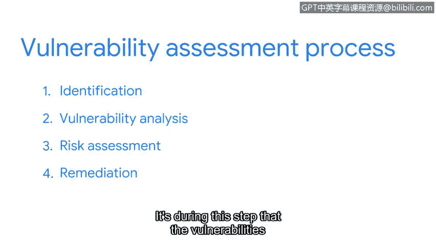

# 谷歌网络安全专业证书第五课：《资产、威胁和漏洞》（中英字幕，前面分p中字，后面分p英字） - P72：26_01_vulnerability-assessments.en_subtitled - GPT中英字幕课程资源 - BV1QM4y1H7sh

Our exploration of the vulnerability management process so far has been focused on a couple of topics。

 We've discussed how vulnerabilities influence the design of defenses。

We've also talked about how common vulnerabilities are shared。

A topic we've yet to cover is how vulnerabilities are found in the first place。

 Wiakes and flaws are generally found during a vulnerability assessment。

 A vulnerability assessment is the internal review process of an organization's security systems。

These assessments work similar to the process of identifying and categorizing vulnerabilities on the CVE list。

The main difference is an organization's security team performs， evaluates scores。

 and fixes them on their own。Security analysts play a key role throughout this process。Overall。

 the goal of a vulnerability assessment is to identify weak points and prevent attacks。

 There are also how security teams determine whether their security controls meet regulatory standards。

Organizations perform vulnerability assessments a lot because companies have so many assets to protect。

 Security teams sometimes need to select which areas to focus on through vulnerability assessments。

Once they decide what to focus on， vulnerability assessments typically follow a four step process。

 The first step is identification here， scanning tools and manual testing are used to find vulnerabilities during the identification step。

 The goal is to understand the current state of a security system。 like taking a picture of it。

A large number of findings usually appeared after identification。

The next step of the process is vulnerability analysis。 During this step。

 each other vulnerabilities that were identified are tested。Like being a digital detective。

 the goal of vulnerability analysis is to find the source of the problem。

The third step of the process is risk assessment。 During this step of the process。

 a score is assigned to each vulnerability。This score is assigned based on two factors。

 How severe the impact would be if their vulnerability were to be exploited and the likelihood of this happening。

Vulnerabilities uncovered during the first two steps of this process often outnumber the people available to fix them。

Risk assessments are a way of prioritizing resources to handle the vulnerabilities that need to be addressed based on their score。

 The fourth and final step of vulnerability assessment is remediation is during this step that their vulnerabilities that can impact the organization are addressed。

 Remediation occurs depending on the severity score assigned during the risk assessment step。

 This part of the process is normally a joint effort between the security staff and I T teams to come up with the best approach to fixing the vulnerabilities that were uncovered earlier。

Examples of remediation steps might include things like enforcing new security procedures。

 updating operating systems or implementing system patches。

 Vulnerability assessments are great for identifying the flaws of a system。

 Most organizations use them to search for problems before they happen。😊。

But how do we know where to search？When we get together again。

 we'll explore how companies figure this out。

