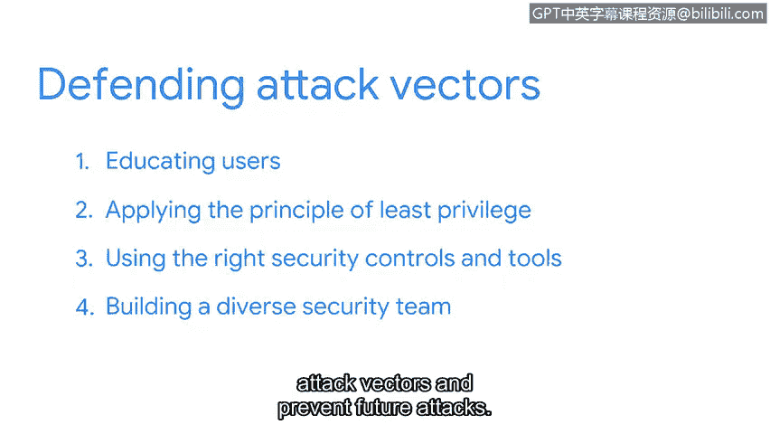

# 谷歌网络安全专业证书第五课：《资产、威胁和漏洞》（中英字幕，前面分p中字，后面分p英字） - P76：30_05_pathways-through-defenses.en_subtitled - GPT中英字幕课程资源 - BV1QM4y1H7sh

To defend against attacks， organizations need to have more than just the understanding of the growing digital landscape around them。

Positioning themselves ahead of a cyber threat also takes understanding the type of attacks that can be used against them。

Last time we began exploring how the cloud has expanded the digital attack surface that organizations protect。

 As a result， cloud computing has led to an increase in the number of attack vectors available。

 attack vectors refer to the pathways attackers use to penetrate security defenses like the doors and windows of a home。

 these pathways are the exploitable futures of an attack surface。

 One example of an attack vector would be social media。

 Another would be removable media like a USB drive。 Most people outside of security。

 assumed that cyber criminalrials are the only ones out there exploiting attack vectors。

 while attack vectors are used by malicious hacks to steal information， Other groups use them， too。

 For example， employees occasionally exploit attack vectors unintentionally。

 this happens a lot with social media platforms Sometimes employees postsensitive company news that shouldn't have been shared at。

😊，This same kind of thing happens on purpose。 Social media platforms are also vectors that disgruntled employees use to intentionally share confidential information that can harm the company。

We all treat attack vectors as critical risk to asset security。

 Attackers typically put forth a lot of effort playing their attacks before carrying them out is up to us as security professionals to put an even greater amount of effort into stopping them。

Security teams do this by thinking of each vector with an attacker mindset。

 This starts with a simple question， how would we exploit this vector。

We then go through a step by step process to answer our question。First。

 when practicing an attacker mindset， we identify a target。 This could be specific information。

 a system， a person， a group or the organization itself。 Next。

 we determine how the target can be accessed。What information is available that an attacker might take advantage of to reach the target based on that information。

 the third step is to evaluate the attack vectors that can be exploited to gain entry。And finally。

 we find the tools and methods of attack。 What will the attackers use to carry this out along the way。

 practicing an attacker mindset provides valuable insight into the best security controls to implement and the vulnerabilities that need to be monitored。

😊，Every organization has a long list of attack vectors to defend。

 and while there are a lot of ways to protect them， there are a few common rules for doing this。

One key to defending attack vectors is educating users about security vulnerabilities。

 These efforts are usually tied to an event。 For example。

 advising them about a new phishing exploit that is targeting users in the organization。

 Another rule is applying the principle of least privilege。

 We've explored at least privilege earlier in this section。

 It's the idea that access rights should be limited to what's required to perform a task。

 like we previously explored， this practice closes multiple security holes inside a organization's attack surface。

 Next， using the right security controls and tools can go a long way towards defending attack vectors。

Even the most knowledgeable employees make security mistakes。

 like accidentally clicking on a malicious link in an email。😊。

Having the right security tools in place， like antivirus software helps to defend attack vectors more efficiently and reduce the risk of human error。

 Last but not least， is building a diverse security team。

 This is one of the best ways to reduce the risk of attack vectors and prevent future attacks。

 Your own unique perspective can greatly improve a security team's ability to apply an attacker's mindset and stay one step ahead of a potential threats。

 keeping yourself informed is always important in this field。 You're already off to a great start。

 So keep up the good work。😊。

