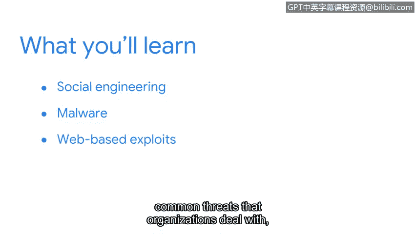

# 谷歌网络安全专业证书第五课：《资产、威胁和漏洞》（中英字幕，前面分p中字，后面分p英字） - P78：32_01_welcome-to-week-4.en_subtitled - GPT中英字幕课程资源 - BV1QM4y1H7sh

Here we are。 The final section of the course。 What an amazing job you've done so far。 Pu in the time。

 dedication and hard work to get to this point is definitely something to celebrate。

 But we're not there yet。 As we near the end of this course。

 Now it' the time to focus and finish strong。 Let's turn our attention to threats。

 We've already explored assets， vulnerabilities and the controls used to protect both A common theme between those two topics has been the wide range of assets and vulnerabilities out there。

😊，The world of threats is no different。If you recall。

 threats are any circumstance or event that can negatively impact assets。 in this part of the course。

 you're going to expand your security mindset by getting a high level view of the most dangerous threats faced organizations today。

First， we're going to begin by exploring social engineering tactics。

 psychological tricks that attackers use to gain unauthorized access to assets。 Next。

 we'll explore a common type of threat that's been around since the start of personal computers。

 malware。😊，We're going to spend some time investigating the major types of malware。 After that。

 we'll turn our attention to web based exploits。 Most organization these days operate in a digital space。

 and many of them are new to it。😊，In this section of the course。

 you're going to learn about some of the most common threats that organizations face online。 Finally。

 after exploring common threats that organizations deal with。

 we're going to wrap up by exploring the threat modeling process。

 Understanding threats is essential for a security analyst。 And there's a lot to cover。

 So let's get started。😊。

