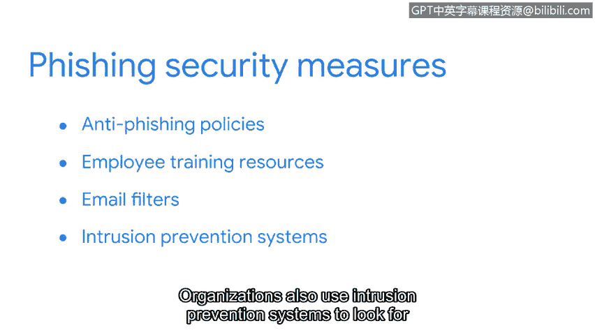

# 谷歌网络安全专业证书第五课：《资产、威胁和漏洞》（中英字幕，前面分p中字，后面分p英字） - P80：34_04_phishing-for-information.en_subtitled - GPT中英字幕课程资源 - BV1QM4y1H7sh

Cyber criminalrimins prefer attacks that do the most amount of damage with the least amount of effort。

One of the most popular forms of social engineering that meets this description is fishing。

Fishing is the use of digital communications to trick people into revealing sensitive data or deploying malicious software。

 phishing leverages and many communication technologies。

 but the term is mainly used to describe attacks that arrive by email。

 Fishing attacks don't just affect individuals。 They are also harmful to organizations。

 A single employee that falls from one of these tricks can give malicious attackers access to systems。

 Once inside， attackers can exploit sensitive data like customer names and product secrets。😊。

Attackers who carry out these attacks commonly use fishing kits。

A fishingishing kit is a collection of software tools needed to launch a ph campaign。

People with little technical background can use one of these kits。

 Each of the tools inside are designed to avoid detection。 As a security professional。

 you should be aware of the three main tools inside a fishing kit so that you can quickly identify when they're being used and put a stop to it。

The first is malicious attachments。 These are fowls that are infected and can cause harm to the organization's systems。

😊，Fish and kits also include fake data collection forms。 These forms look like legitimate forms。

 like a survey。Unlike a real survey， they ask for sensitive information that isn't normally asked for in an email。

 The third resource they include are fraudulent web links。

 These open to malicious web pages that are designed to look like trusted brands。😊。

Unlike actual websites， these fraudulent sites are built to steal information like login credentials。

 cyber criminals can use these tools to launch a phishing attack in many forms。

 The most common is through malicious emails。 However。

 they can use them in other forms of communication， too。😊，Most recently。

 cyber criminals are using missioning and wishing to trick people into revealing private information。

😊，Smishing is the use of text messages to obtain sensitive information or to impersonate a known source。

 You probably received these type of messages before。

Not only are sishing messages annoying to receive。 They're also difficult to prevent。

 That's why some attackers send them。 Some sishing messages are easy to detect。

 They might show signs of being malicious， like promising a cash reward for clicking an attached link that shouldn't be clicked。

Other times， missing is hard to spot。Attackers sometimes use local area codes to appear legitimate。

 Some hackers can even send messages disguised as friends and families of their target to fool them into disclosing sensitive information。

Viishing is the exploitation of electronic voice communication to obtain sensitive information or impersonate a known source。

 during vishing attacks， criminals pretend to be somewhere they're not。 For example。

 attackers might call pretending to be a company representative。

 They might claim that there's a problem with your account。

 and they can offer to fix it if you provide them with sensitive information。

Most organizations use a few basic security measures to prevent these and any other types of efficient attacks from becoming a problem。

For example， antifission policies spread awareness and encourage users to follow data security procedures correctly。

Employ training resources also help inform employees about things to look for when an email looks suspicious。

 Another line of defense against phishing is securing email inboxes。

 E filters are commonly used to keep harmful messages from reaching users。 For example。

 specific email addresses can be blocked using a block list。

 Organizations often use other filters like allow list to specify IP addresses that are approved to send mail within the company。

😊，Organizations also use intrusion prevention systems to look for unusual patterns in email traffic。

Security analysts use monitoring tools like this to spot suspicious emails。

 quarantine them and produce a log of events。Fishing campaigns are popular in dangerous forms of social engineering that organizations of all sizes need to deal with。

 Just a single compromised password that an attacker can get their hands on can lead to a costly data breach。

 Now that you're familiar with the tools these attackers use。

 You're better equipped to spot fishing and prevent it。

