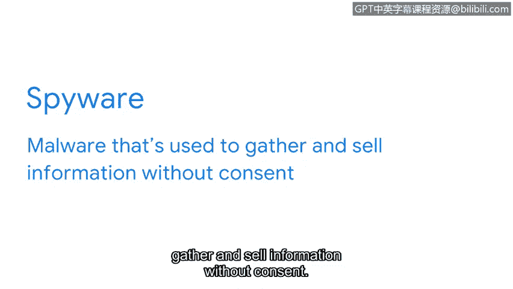

# 谷歌网络安全专业证书第五课：《资产、威胁和漏洞》（中英字幕，前面分p中字，后面分p英字） - P81：35_01_malicious-software.en_subtitled - GPT中英字幕课程资源 - BV1QM4y1H7sh

People and computers are very different from one another。 There is one way that we're alike。

You know how we're both vulnerable to getting an affection。

While humans can be infected by a virus that causes a cold or flu。

 computers can be infected by malware。Mtware is software designed to harm devices or networks。

Mowware， which is short for malicious software， can be spread in many ways， for example。😊。

It could be spread through an affected USB drive， or also commonlyly spread between computers online。

Devices and systems that are connected to the Internet are especially vulnerable to infection。

When a device becomes infected， malware interferes with its normal operations。

Attackers use malware to take control of the infected system without the user's knowledge or permission。

Maware has been a threat to people and organizations for a long time。

Attackers have created many different strains of malware。They all vary in how they're spread。

Five of the most common types of malware are a virus， warm， Trojan， ransomware， and spyware。

Let's take a look at how each of them work。A virus is malicious code written to interfere with computer operations and cause damage to data and software。

Viruses typically hide inside of trusted applications。When the infected program is launched。

 the virus clones itself and spreads to other files on the device。

An important characteristic of viruses is that they have to be activated by the user to start the infection。

The next kind of outward doesn't have this limitation。😡。

A worm is malware that can duplicate and spread itself across systems on its own。

While viruses require users to perform an action like opening a file to duplicate。

 worms use an affected device as a host。They scan the connected network for other devices。

Worms then infect everything on the network without requiring an action to trigger the spread。

Viruses and worms are delivered through phishing emails and other methods before they infect a device。

 Ma sure you click links only from trusted sources is one way to avoid these types of infection。

 However， attackers have designed another form of malware that can get past this precaution。

A Trojan or Trojan horse is maware that looks like a legitimate file a program。

The name is a reference to an ancient Greek legend that's set in the city of Troy。In Troy。

 a group of soldiers hid inside a giant wooden horse that was presented as a gift to their enemies。

It was accepted and brought inside the city walls。Later that evening。

 the soldiers inside of the horse climbed out and attacked the city。Like this ancient tell。

 attackers design Trojans to appear harmless。 This type of malware is typically disguised as files or useful applications to trick their target into installing them。

Attackers often use Trojans to gain access and install another kind of malware called ransomware ransomware is a type of malicious attack where attackers encrypted organizations data and demand payment to restore access。

These kind of attacks have become very common these days。

 A unique feature of ransomware attacks is that they make themselves known to their targets。

Without doing this， they couldn't collect the money they demand。Normally。

 they decrypt the hidden data as soon as the sum of money is paid。Unfortunately。

 there's no guarantee they won't return to demand more。

The last type of malware I want to mention is Spyware。

 Spyware is malware that used to gather and sell information without consent。 Cons is a key word。

 In this case， Organs also collect information about their customers。

 like their browsing habits and purchase history。 However。

 they always give their customers the ability to opt out。😊。

Cyber criminalriminals， on the other hand， use spyware to steal information。

 they use spyware attacks to collect data like login credentials。

 account pins and other types of sensitive information for their own personal gain。

There are many other types of malware besides these， and new forms are always evolving。

 They all pose a serious risk to individuals and organizations。 Next time。

 we'll explore how security teams detect and remove these kinds of threats。

