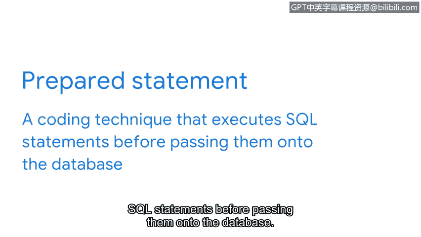

# 谷歌网络安全专业证书第五课：《资产、威胁和漏洞》（中英字幕，前面分p中字，后面分p英字） - P85：39_02_exploitable-gaps-in-databases.en_subtitled - GPT中英字幕课程资源 - BV1QM4y1H7sh

Let's keep exploring injection and tax by investigating another common type of web based exploit。

The next one we're going to discuss is exploit the way websites access information from databases。

Early in the program， you may have learned about SQL。

You may recall SQL is a programming language used to create。

 interact with and request information from a database。SQL is used by most Web applications。

 For example， shopping websites use it a lot。Imagine the databases of an online clothing store。

It likely contains a full inventory of all the items the company sells。

Websites don't normally make users enter the SQL queries manually。 Instead。

 they use things like menus， images and buttons to show users information in a meaningful way。

For example， when an online shopper clicks a button to add a sweater to their cart。

 it triggers a SQL query。The query runs in the background where no one can see it。

Youll never know from using the menus and buttons of a website。

 but sometimes those back inqueries are vulnerable to injection attacks。

A SQL injection is an attack that executes unexpected queries on a database。

Like cross site scripting， SQL injection occurs due to the lack of sanitized input。

The injections take place in an area of the website that are designed to accept user input。

A common example is the login form to access a site。

One of these forms might trigger a backend SQL statement like this when a user enters their credentials。

Web forms like this one are designed to copy user input into the statement exactly as they're written。

The statement then sends a request to the server， which runs the query。

Websites that are vulnerable to SQL injection inserts the user input exactly as is entered before running the code。

Unfortunately， this is a serious design flaw。 It commonly happens because web developers expect people to use their inputs correctly。

They don't anticipate attackers exploiting them。For example。

 an attacker might insert additional SQL code。 This could cause the server to run a harmful query of code that wasn't inspecting。

Miicious hackers can target these attack vectors to obtain sensitive information。

 modifying tables and even gain administrative rights to the database。

The best way to defend against SQL injections is code that will sanitize the input。

Develop books and write code to search for specific SQL characters。

 This gives the server a clearer idea of what inputs to expect。

 One way this is done is what prepared statements。😊。

A prepared statement is a coding technique that executes SQL statements before passing them into the database。

When the user input is unknown， the best practice is to use these prepared statements。

With just a few extra lines of code， a prepared statement executes the code before passing it onto the server。

 This means the code can be validated before performing the query。

Having well written code is one of the keys to preventing SQL injection。

Security teams work with program developers to test applications for these sort of vulnerabilities。

Like a lot of security tasks， it's a team effort。Injection attacks are just one of many types of web based exploits that security teams deal with。

 We're going to explore how security teams prepare for injection attacks and other kinds of threats。

