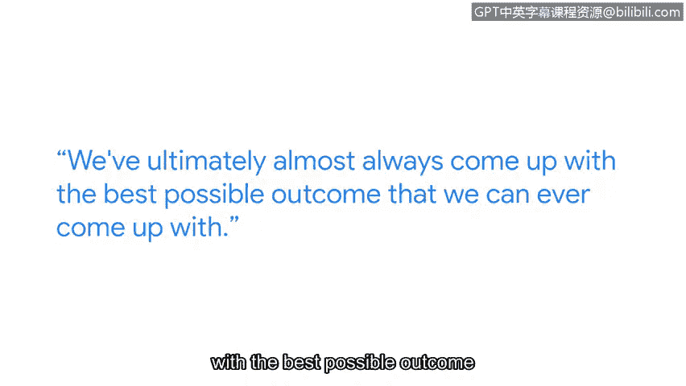

# 谷歌网络安全专业证书第五课：《资产、威胁和漏洞》（中英字幕，前面分p中字，后面分p英字） - P87：41_02_chantelle-the-value-of-diversity-in-cybersecurity.en_subtitled - GPT中英字幕课程资源 - BV1QM4y1H7sh

My name is Chel， I'm a security engineer here at Google and I am part of the security and implementment and scaling team。

 we secure and monitor systems that contains sense information my background initiallynitially I was going be a heart surgeon and then I took chemistry I took Che1 and I was like nah that's not happening so my interest in the cybersecurity came from a TV show called Mr。

 robot is about a vigilante hacker trying to save the world and from there that kind ofique my interest in security and served as a great foundation valuing diversity and securitycur is important because we're exposed to a broad range of thinking that helps to inspire a lot of creative ideas。

And different perspectives and different ways of tackling a problem。

 And that kind of like leads us forward into being better security engineers。

 Our manager Lauren always steps in to tell us， you know， don't be so quick to find a solution。

 Don't be so quick to solve the problems yourselves。

 You know we have a wide range of security engineers and connections to our disposal and she encourages us to go out and seek them out and then to come back and then have us settle in and brainstorm all of these ideas that we've collected after we've went out and try to find it。

 We've ultimately almost always come up with the best possible outcome that we can ever come up with。

 My advice for people to get into the industry is get out there and be proactive。

 I would definitely suggest hack the box or try me hack co。

 I definitely recommend joining up the security community on Twitter。

 There's a huge security community。

In Twitter right now that shares a bunch of like resources， opportunities。

 job positions and are definitely open to talking to anyone that's interested in getting into into the field where just don't know how I recommend security as as a career。

Definitely， I think that for me personally， I was able to to tap into my rebel side a lot in insecurity。

 I found I was able to express myself a bit more insecurity。 It's just a whole。😊，Ball of goodness。

