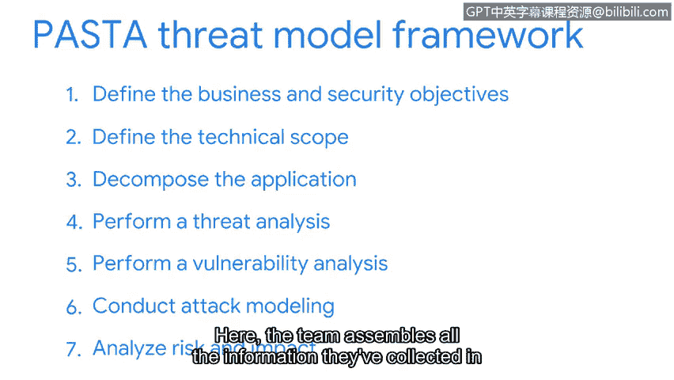

# 谷歌网络安全专业证书第五课：《资产、威胁和漏洞》（中英字幕，前面分p中字，后面分p英字） - P88：42_03_pasta-the-process-for-attack-simulation-and-threat-analysis. - GPT中英字幕课程资源 - BV1QM4y1H7sh

Let's finish exploring threat modeling by taking a look at real world scenarios。This time。

 we'll use a standard threat modeling process called Paa。

 Imagine that a fitness company is getting ready to launch their first mobile app。😊。

Before we can go live， the company asked their security team to ensure the app will protect customer data。

The team decides to perform a threat model using the pasta framework。

 Paa is a popular threat modeling framework that's used across many industries。

 Paa is short for a process for attack simulation and threat analysis。

There are seven stages of the pasta framework。Let's go through each of them to help this fitness company get their app ready。

 Stage 1 of the Pasa threat model framework is to define business and security objectives。

 Before starting the threat model， the team needs to decide what their goals are。

 The main objective in our example with the fitness company app is protecting customer data。

The team starts by asking a lot of questions at this stage。

 they'll need to understand things like how personally identifiable information is handled。

Answering these questions is a key to evaluating the impact of threats that they'll find along the way。

 Sage 2 of the pasta framework is to define the technical scope。 Here。

 The team's focus is to identify the application components that must be evaluated。

 This is what we discussed earlier， as the attack surface。For a mobile app。

 this will include technology that's involved while data is at risk and in use。

 This includes network protocols， security controls and other data interactions At stage 3 Apaa。

 the team's job is to decompose the application。In other words。

 we need to identify the existing controls that would protect user data from threats。

 This normally means working with the application developers to produce a data flow diagram。

A diagram like this would show how data gets from a user's device to the company's database。

 It would also identify the controls in place to protect this data along the way。

Stage 4posta is next。 The focus here is to perform a threat analysis。

This is where the team gets into their attacker mindset。Here。

 research is done to collect the most up to date information on the type of attacks being used。

Like other technologies， mobile apps have many attack vectors。These change regularly。

 so the team would reference resources to stay up to date。

 Stage 5 Apaa is performing a vulnerability analysis。 In this stage。

 the team more deeply investigates potential vulnerabilities by considering the root of the problem。

Next is stage 6， a pasta， where the team conducts attack modeling。

 This is where the team tests the vulnerabilities that were analyzed in stage 5 by simulating attacks。

 The team does this by creating an attack tree， which looks like a flow chart， For example。

 an attack tree for our mobile app might look like this。

 Custom information like username and passwords is a target。

This data is normally stored in a database。We've learned that databases are vulnerable to attacks like SQL injection。

So we will add this attack vector to our attack tree。

A threat actor might exploit vulnerabilities caused by unsanitized inputs to attack this vector。

The security team uses attack trees like this to identify attack vectors that need to be tested to validate threats。

This is just one branch of this attack tree。An application like a fitness app typically has lots of branches with a number of other attack vectors。

 Stage 7 of Pasa is to analyze risk and impact。 Here。

 the team assembles all the information they' collected in stages 1 through 6。 By this stage。

 the team is in position to make informed risk management recommendations to business stakeholders that align with their goals。

 And with that， we made it all the way through a threat modeling exercise based on the Pasa framework。

😊。

