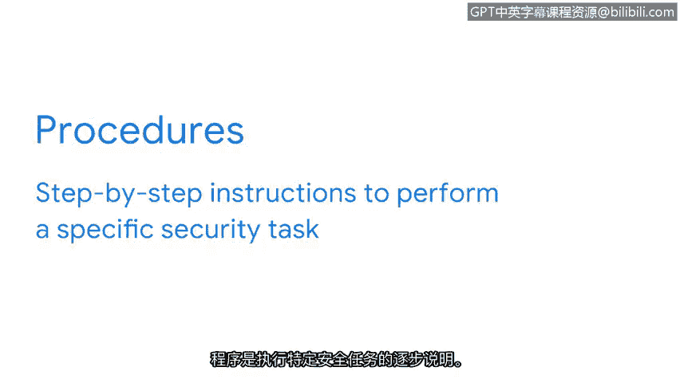

# 谷歌网络安全专业证书第五课：《资产、威胁和漏洞》（中英字幕，前面分p中字，后面分p英字） - P8：7_安全计划的要素.zh - GPT中英字幕课程资源 - BV1QM4y1H7sh

Security is all about people， processes and technology。 It's a team effort。

 And I mean that literally protecting assets extends well beyond one person or a group of people in an I T department。

 The truth of the matter is that security is a culture。

 It's a shared set of values that spans all levels of an organization。

 These values touch everyone from employees to vendors to customers。

Protecting digital and physical assets requires everyone to participate， which can be a challenge。

 That's what security plans are for。Plans come in many shapes and sizes。

 but they all share a common goal to be prepared for risks when they happen。

 placing the focus on people is what leads to the most effective security plans。

Considering the diverse backgrounds and perspectives of everyone involved。

 ensure that no one is left out when something goes wrong。

 We talked earlier about the risk as being anything that can impact the confidentiality。

 integrity or availability of an asset。Most security plans address risks by breaking them down according to categories and factors。

 Some common risk categories might include the damage， disclosure or loss of information。

Any of these can be due to factors like the physical damage or malfunctions of a device。

 There are also factors like attacks and human error。 For example。

 a new school teacher may be asked to sign a contract before their first day of class。

 The agreement may warn against some common risks associated with human error。

 like using a person email to send sensitive information。

 A security plan may require that all new hires sign off on this agreement。

 effectively spreading the values that ensure everyone's in alignment。

This is just one example of the types and causes of risks that a plan might address。

 These things vary widely， depending on the company。

 But how these plans are communicated is similar across industries。

 Security plans consists of three basic elements。 policies， standards and procedures。

 These three elements are how companies share their security plans。

 These words tend to be used interchangeably outside of security。

 But youll soon discover that they each have a very specific meaning and function in this context。

 A policy and security is a set of rules that reduce risks and protects information。

 policies are the foundation of every security plan。

 They give everyone in and out of an organization guidance by addressing questions like what are we protecting and why policies focus on the strategic side of things by identifying the scope。

 objectivesjectives and limitations of a security plan。For instance。

 newly hired employees at many companies are required to sign off on an acceptable use policy or AUP。

 These provisions outline secure ways that an employee may access corporate systems。

Standards are the next part。 These have a tactical function as they concern how well we're protecting assets。

In security standards are references that inform how to set policies。

 A good way to think of standards is that they create a point of reference。 For example。

 many companies use the password management standard identified in this special publication，800 6。

3 B to improve their security policies by specifying that employees passwords must be at least 8 characters long。

 The last part of a plan is its procedures。 Procures are step by step instructions to perform a specific security task。

Organizations usually keep multiple procedure documents that are used throughout the company。

 like how employees can choose secure passwords or how they can securely reset a password if it's been locked。

Sharing clear and actionable procedures with everyone creates accountability。

 consistency and efficiency across an organization。😊，Policies。

 standards and procedures vary widely from one company to another because they are tailored to each organization's goals。

Simply understanding the structure of security plans is a great start。 For now。

 I hope you have a clearer picture of what policies。

 standards and procedures are and how they are essential to making security a team effort。😊。

