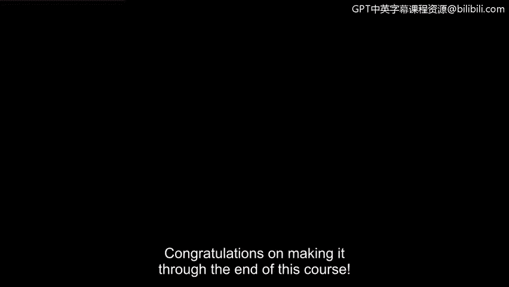
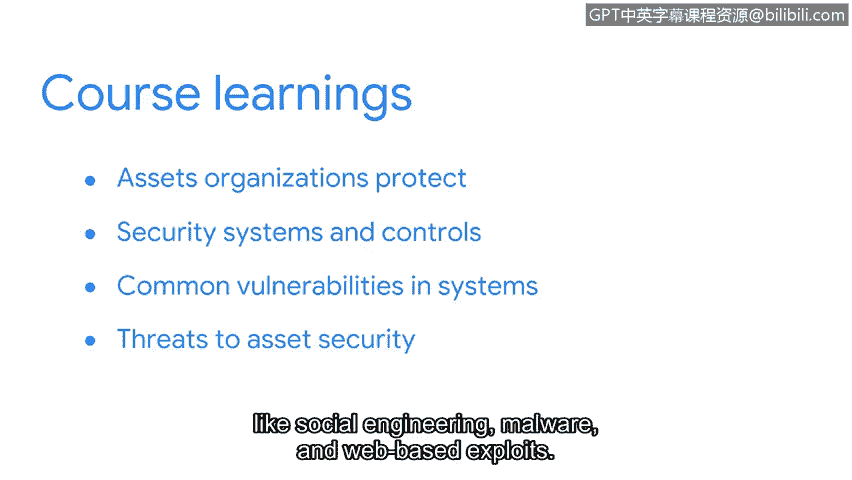

# 谷歌网络安全专业证书第五课：《资产、威胁和漏洞》（中英字幕，前面分p中字，后面分p英字） - P90：44_01_course-wrap-up.en_subtitled - GPT中英字幕课程资源 - BV1QM4y1H7sh

Congratulations on making it through the end of this course。😊。

I can hardly believe our time together is over。 Before moving on in the certificate program。

 I like to reflect on all the amazing progress you've made。 When we started。

 you were introduced to a wide range of assets。 organizations protect。

 Our primary focus was information security， specifically digital information。😊，Here。

 you learned how asset classification helps security teams focus their efforts and prioritize resources。

We explored digital assets in the three states of data。 We also learned how policies。

 standards and procedures can mitigate organizational risks。

 Our focus on the NIS cybersecurity framework introduce you to a commonly used framework for managing risks。

 Afterwards， you learned about fundamental security systems and controls。😊。

You got to explore technology like encryption that's used to protect data in all its states。

You also learned how technologies like public key infrastructure and digital certificates are used to maintain the confidentiality。

 integrity， and availability of information online。

 and you also explored access controls that make up the authentication。

 authorization and accounting framework。Next， we explore common vulnerabilities and systems During this part of the course。

 you got an inside look into how security teams position themselves ahead of attacks。

 We explore the defense and death strategy that supplied to protect information as is exchange between parties online。

You also learned about the common vulnerability and exposures list。

 the vulnerability assessment process and attack surfaces and attack vectors。

We then explored the major threats to asset security， like social engineering。

 malware and web based exploits。 Together， we discuss how these attacks are carried out and the ways security teams prevent them from doing damage。

We then finish up by exploring the process of threat modeling。We covered so much。

 I really appreciate your effort through it all。When I first started my career in security。

 my goal was to learn， network， and embrace any opportunity。

I was able to attend security conferences， received job tips， earned references。

 and volunteered to gain experience。😊，At that time。

 I would have never imagined that'll be here teaching what I've learned to others。

 That just goes to show you your security journey is only just beginning。

 While our time together is over， we covered a lot of complex topics。

 many of which are areas of specialization and security。With the foundation you built here。

 you have a wide range of possibilities to continue growing in the field。

I'm so glad to have played a part in this step along your journey into the world of security。

 and I wish you all the best as you continue forward along your path。😊。

