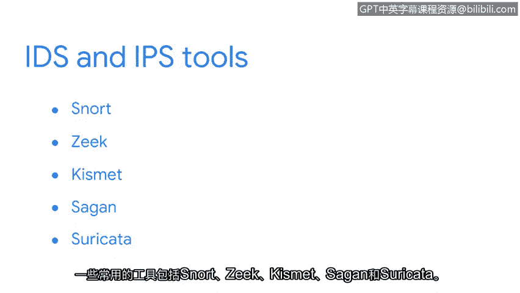

# 谷歌网络安全专业证书第六课：《拉响警报：检测与响应》（中英字幕，前面分p中字，后面分p英字） - P10：9_入侵检测系统.zh - GPT中英字幕课程资源 - BV1eV41157nD

In this video， we'll introduce you to intrusion detection and intrusion prevention systems。

Imagine that you have just installed a home intrusion security system。

 You've installed intruder sensors for each entry and exit point in your home。

 including doors and windows。Those sensors work by sending out sound waves。

 And when an object touches a sound wave， the waves bounce back to your sensor and trigger an alert to your phone。

 notifying you that an intrusion was detected。An intrusion detection system or IDS works in a very similar way to home intrusion sensors。

 an intrusion detection system is an application that monitors system and network activity and produces alerts on possible intrusions。

Like the home intrusion sensor， I D S collects and analyze system information for abnormal activities。

 If something unusual is detected， the I S sends out an alert to appropriate channels and personnel。

 Now， imagine a jewelry storefront with a window sensor When the sensor detects that the windows glass has been shattered。

 It triggers a steel roll up door to automatically replace the shattered window and prevent unauthorized entry into the store。

This is what an intrusion prevention system does Intrusion prevention systems or IPS have all the same capabilities as an IDS。

 but they can do more， they monitor system activity for intrusions and take action to stop it。

Many tools have the ability to perform the function of both I D S and IPS S。

 Some popular tools are snort， Zeke， Kismmet， Seon and Surrokata。

We will be exploring Sararokata in upcoming lessons。

 You might be wondering where do these alert notifications go Well coming up we'll discuss how to manage alerts using security information and event management tools。

