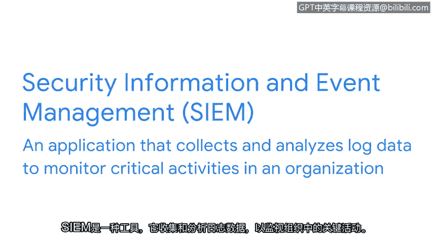
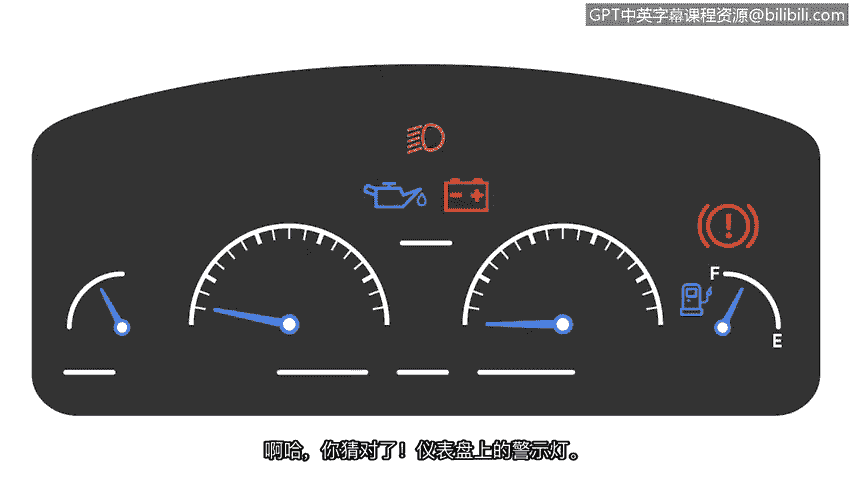
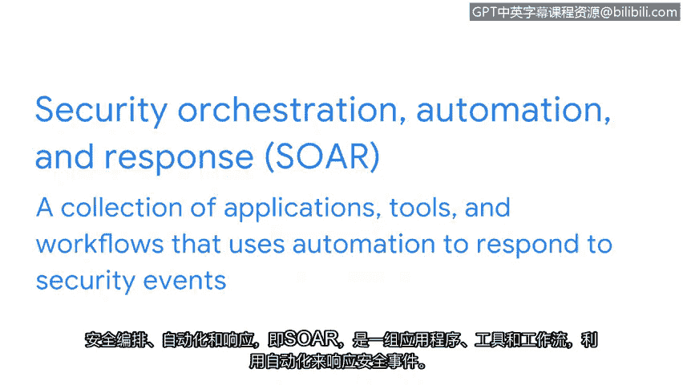

# 谷歌网络安全专业证书第六课：《拉响警报：检测与响应》（中英字幕，前面分p中字，后面分p英字） - P11：10_使用SIEM和SOAR工具进行警报和事件管理.zh - GPT中英字幕课程资源 - BV1eV41157nD

Our discussion on detection tools may have left you wondering where alerts are sent and how alerts are accessed by security analysts。

 This is where security information and event management or Sim tools are used。

Sim is a tool that collects and analyzes log data to monitor critical activities in an organization。

 Sim provides security professionals with a high level overview of what goes on in their networks。

How exactly does it do this？Let's use an example of a car。 Cars have many different parts， Tis。

 lights， And let's not forget all the internal machinery that's under the hood。

 There are many different components of a car。 But how do you know if one of them has an issue。Aha。

 you guessed it。 The dashboard warning lights。 The dashboard notifies you about information related to the car's components。

 whether the tire pressure or battery voltage is low。

 you need to refuel or a door hasn't been properly closed。

A car's dashboard notifies you about the status of the car's components so that you can take action to fix it。

 Sim tools work in a similar way。 Just like cars have many different components。

 A network can have thousands of different devices and systems。

 which make monitoring them quite the challenge。 A car's dashboard gives the driver a clear picture of the status of their car。

 so they don't have to worry about inspecting each component themselves。Similarly。

 a SIim looks at data flows between all the different systems in a network and analyzes them to provide a real time picture of any potential threats to the network。

It does this by ingesting massive amounts of data and categorizes this data so that it's easily accessible through a centralized platform similar to a car's dashboard。

Here's what the process looks like。 First， Sim tools collect and aggregate data。

 This data is typically in the form of logs， which are basically a record of all the events that happen on a given source。

Data can come from multiple sources such as IDS or IPS， databases， firewalls， applications， and more。

After all this data gets collected， it gets aggregated。

 Aggregation simply means all this data from different data sources gets centralized in one place。

 depending on the number of data sources a Sim collects from a huge volume of raw unedited data can get collected。

 and not all data that's collected by a Sim is relevant for security analysis purposes。Next。

 Sim tools normalize data。 normalmalization takes the raw data that the Sim has collected and cleans it up by removing nonesential attributes so that only what's relevant is included。

 Data normalization also creates consistency in log records。

 which is helpful when you're searching for specific log information during incident investigation。

Finally， the normalized data gets analyzed according to configured rules。

 SIM analyzes the normalized data against a rule set to detect any possible security incidents which then get categorized or reported as alerts for security analysts to review。

Now that you've explored the capabilities of SIM tools。

 let's examine another security management tool， security， orchestration， automation and responsepon。

 or SOAR is a collection of applications， tools and workflows that uses automation to respond to security events。

While Sim tools collect， analyze and report on security events for security analysts to review。

 SOA automates analysis and response to security events and incidents。

SoOR can also be used to track and manage cases， multiple incidents can form a case and SOR offers a way to view all of these incidents in one centralized place。

Well there you have it， you've learned how incident management tools like SIim and SAR make it easier for security analysts to see what's happening in a network and to respond to any threats efficiently。

